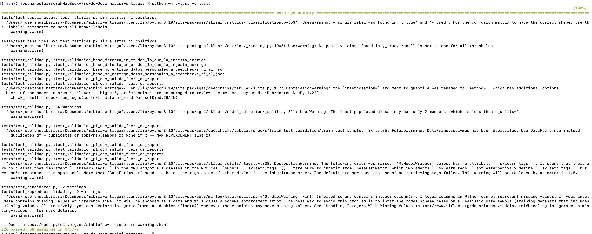
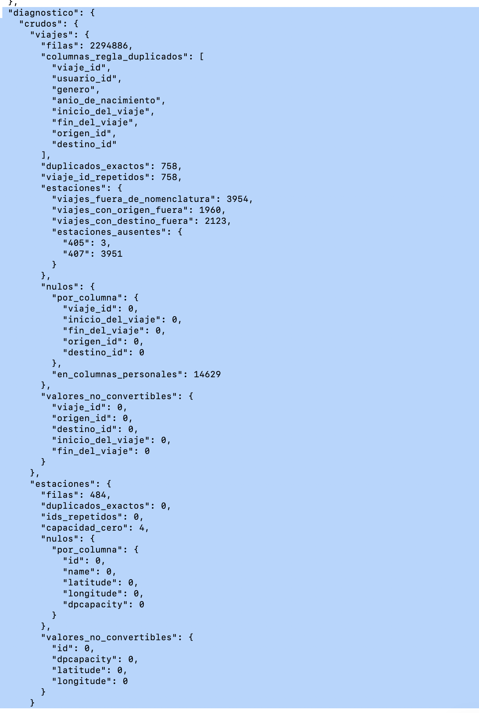
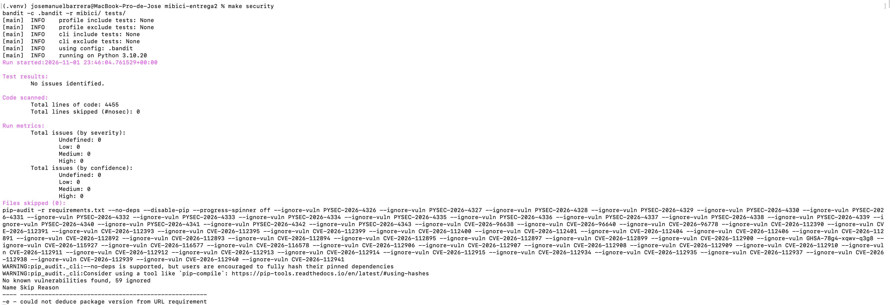
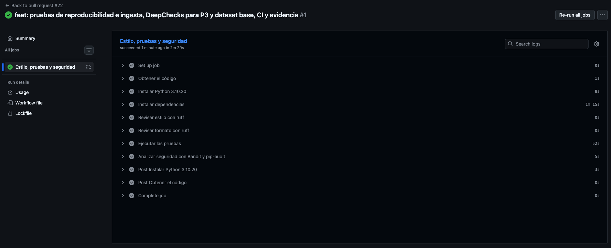
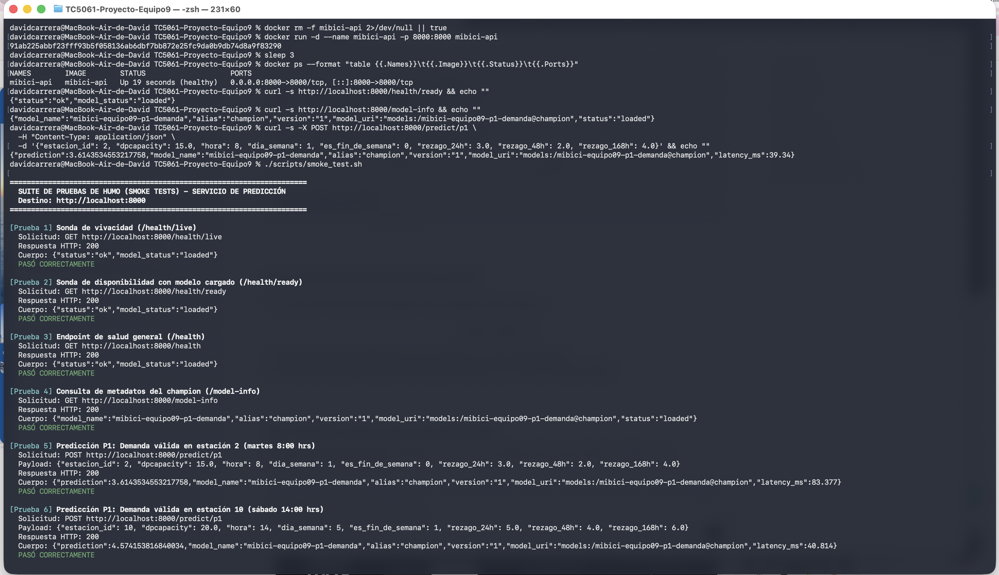
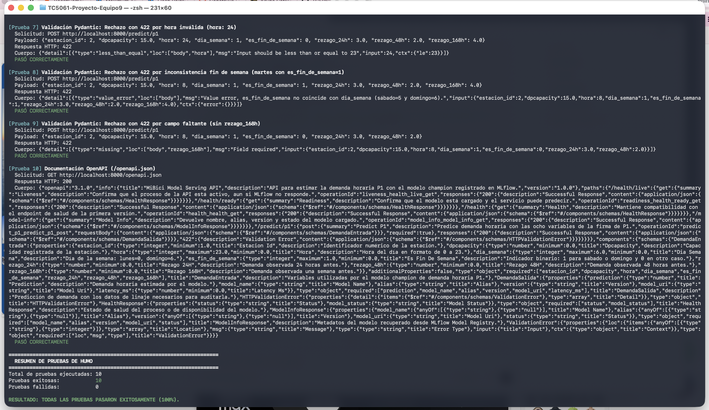

# MiBici: demanda, riesgo de rebalanceo y patrones de uso

[](https://github.com/a01840021-creator/TC5061-Proyecto-Equipo9/actions/workflows/ci.yml)

Proyecto integrador del equipo 9. Propone y construye una solución de Machine Learning sobre los datos abiertos de MiBici, el sistema de bicicleta pública del Área Metropolitana de Guadalajara, para responder tres preguntas de operación.

## Integrantes

### Entrega 1: propuesta y base reproducible

| Matrícula | Nombre | Contribución |
| --- | --- | --- |
| A01840021 | Carrera Rojas, Mariana Judith | Configuración inicial: estructura con Cookiecutter Data Science, repositorio en GitHub y protección de la rama principal |
| A01797854 | Barrera Mendoza, José Manuel | Formulación del problema y ML Canvas, definición de los datos, dependencias con versión fija, ingesta reproducible y versionado de datos, flujo de trabajo con Git |
| A01797868 | Barranco Cruz, Luis Fernando | Implementación de los baselines P1, P2 y P3; instrumentación con MLflow Tracking; métricas, artefactos y pruebas automatizadas |
| A01840136 | Carrera Castillo, David | Análisis exploratorio, módulo reutilizable de feature engineering sin fuga temporal y diagrama de arquitectura |

### Entrega 2: MLflow Project y tracking avanzado

| Integrante | Matrícula | Contribución | Evidencia |
| --- | --- | --- | --- |
| Carrera Rojas, Mariana Judith | A01840021 | Configuración inicial del MLflow Project, con los primeros puntos de entrada en `MLproject` y la declaración del entorno en `python_env.yaml`; revisión del reporte final y actualización de la documentación. | PR #12 (propuesta inicial, posteriormente sustituida y cerrada sin fusionar) y revisión aprobatoria del PR #16. |
| Barrera Mendoza, José Manuel | A01797854 | Modelos candidatos por algoritmo, corrección de fugas temporales en P2 y P3, selección automática mediante los aliases `champion` y `challenger`, linaje en Model Registry, corridas finales y reporte. | PR #15 y #16; revisión aprobatoria del PR #14. |
| Barranco Cruz, Luis Fernando | A01797868 | MLflow Project con puntos de entrada parametrizados, búsquedas con nested runs, registro estructurado de artefactos y primera automatización del Model Registry. | PR #13; revisión aprobatoria del PR #15. |
| Carrera Castillo, David | A01840136 | Primera versión del reporte de experimentos e integración de capturas y evidencias de MLflow. | PR #14; revisión aprobatoria del PR #13. |

*Nota:* El PR #12 se cerró sin fusionarse porque su configuración inicial fue sustituida y ampliada mediante los PR #13 y #15.

### Entrega 3: pruebas, calidad de datos y seguridad

| Integrante | Matrícula | Contribución | Evidencia |
| --- | --- | --- | --- |
| Carrera Rojas, Mariana Judith | A01840021 | Prueba de reproducibilidad del baseline de P3 con semilla fija. | PR #18. |
| Barranco Cruz, Luis Fernando | A01797868 | Integración de DeepChecks para P1 y P2 (nulos, duplicados y drift), pruebas sintéticas e interpretación de hallazgos. | PR #19 y revisión aprobatoria del PR #18. |
| Barrera Mendoza, José Manuel | A01797854 | Corrección de los chequeos de seguridad y fijación completa de dependencias (PR #21); pruebas de reproducibilidad del entrenamiento, pruebas de la ingesta, cobertura de funciones clave, DeepChecks para P3 y el dataset base, workflow de integración continua y evidencia (PR #22). | PR #21 y #22; revisión aprobatoria del PR #20. |
| Carrera Castillo, David | A01840136 | Bandit, pip-audit, `.env.example`, exclusiones de `.gitignore` y reporte de riesgo residual. | PR #20 y revisión aprobatoria del PR #19. |

### Entrega 4: API REST en contenedor

| Integrante | Matrícula | Contribución | Evidencia |
| --- | --- | --- | --- |
| Carrera Rojas, Mariana Judith | A01840021 | Servicio de carga del modelo desde el Model Registry por nombre y alias (`app/model_service.py`), configuración por variables de entorno, endpoints `/health` y `/model-info` y sus pruebas. | PR #23. |
| Barranco Cruz, Luis Fernando | A01797868 | Endpoint `POST /predict/p1` con esquemas de Pydantic para la entrada y la salida, endpoints `/health/live` y `/health/ready` y pruebas de validación con casos límite. | PR #24 y revisión aprobatoria del PR #23. |
| Barrera Mendoza, José Manuel | A01797854 | Imagen de Docker con usuario sin privilegios y `HEALTHCHECK`, dependencias fijadas de la imagen, exportación del champion de P1 desde el Model Registry a `models/p1/`, carga del modelo empaquetado en la API, pruebas, Bandit y pip-audit sobre el servicio y documentación. | PR #25 y revisión aprobatoria del PR #24. |
| Carrera Castillo, David | A01840136 | Pruebas integrales y de humo (`scripts/smoke_test.sh`), automatización en Makefile (`make smoke-test`), reporte de evidencias y documentación técnica del servicio en contenedor (`docs/evidencias/`). | PR #26 y revisión aprobatoria del PR #25. |

### Entrega 5: monitoreo, drift y A/B testing

| Integrante | Matrícula | Contribución | Evidencia |
| --- | --- | --- | --- |
| Carrera Rojas, Mariana Judith | A01840021 | Reporte de data drift con Evidently (`mibici/monitoring/drift.py`), ventanas de referencia (abril a julio) y actual (agosto y septiembre), chequeos de los datos de cada ventana y sus pruebas. | PR #27. |
| Barranco Cruz, Luis Fernando | A01797868 | Interpretación del drift por variable y por rol (`mibici/monitoring/interpretacion.py`), política de continuous training y `references/interpretacion_drift.md`. | PR #28 y revisión aprobatoria del PR #27. |
| Carrera Castillo, David | A01840136 | Módulo de A/B testing de P1 (`mibici/monitoring/ab_test.py`): carga de modelos, métricas de error y latencia, pruebas pareadas por fila (t y Wilcoxon), challenger de referencia entrenado de abril a agosto, recomendación de promoción, sus pruebas y documentación del monitoreo. | PR #29 y revisión aprobatoria del PR #28. |
| Barrera Mendoza, José Manuel | A01797854 | Challenger reentrenado hasta el 15 de septiembre con los hiperparámetros y la semilla del champion (`mibici/modeling/challenger.py`), registrado como versión 3 con linaje, instantánea del código y alias `challenger`; exportación a `models/p1_challenger/` con el periodo de entrenamiento en `metadata.json`; en el A/B, análisis por día con bootstrap y t pareada, verificación de que la evaluación es posterior al entrenamiento de cada modelo, JSON estricto con precisión completa y comparación de tres modelos; drift de la primera quincena de septiembre; pruebas y documentación. | PR #30 y revisión aprobatoria del PR #29. |

## Preguntas del proyecto

| # | Pregunta | Tarea | Quién la usa |
| --- | --- | --- | --- |
| P1 | ¿Cuántos viajes se iniciarán en una estación o zona en un periodo futuro? | Regresión | Operador del sistema, para planear la flota |
| P2 | ¿Una estación estará en riesgo de quedarse sin bicicletas o sin anclajes? | Clasificación | Equipo de rebalanceo |
| P3 | ¿Qué grupos de estaciones comparten patrones de uso y dónde se ubican? | Clustering | Planeación urbana y expansión del sistema |

## Datos

- **Fuente:** [datos abiertos de MiBici](https://mibici.net/es/datos-abiertos/). Las URLs exactas de cada archivo están en `mibici/config.py`.
- **Rango:** abril a septiembre de 2026. Termina en el mismo mes que la nomenclatura de estaciones (`nomenclatura_2026_09.csv`), para que la capacidad y la ubicación de cada estación correspondan al final del periodo. Las 484 estaciones de esa nomenclatura incluyen 14 cuyo nombre lleva el prefijo "ex-"; ninguna de ellas registra viajes entre abril y septiembre. La nomenclatura no explica el prefijo.
- **Tamaño:** 2,294,886 registros crudos. Se eliminan 758 duplicados exactos y 3,954 viajes de dos estaciones (405 y 407) que no aparecen en la nomenclatura. Quedan **2,290,174 viajes** y **484 estaciones**.
- **Datos personales:** se eliminan en la ingesta `usuario_id`, `genero` y `anio_de_nacimiento`. Ninguna de las tres preguntas los necesita y no se registran en MLflow ni en el repositorio.
- **Partición:** temporal, para que ningún modelo se entrene con información posterior al periodo que predice. Los candidatos de P1 y P2 se entrenan de abril a julio, se validan en agosto y se prueban en septiembre; los baselines de P1 y P2 se evalúan en agosto y septiembre. El challenger reentrenado de P1 se entrena del 1 de abril al 15 de septiembre y se compara con el champion del 16 al 30 de septiembre (ver [Monitoreo, drift y A/B testing](#monitoreo-drift-y-ab-testing)). En P3, los perfiles usan las salidas iniciadas y las llegadas terminadas antes del 1 de septiembre.
- **Versionado:** `references/manifiesto_datos.json` guarda la URL, el número de registros y el hash SHA-256 de cada archivo crudo, y una `version_datos` que se registra como parámetro en cada run de MLflow.

## Instalación

Requiere [uv](https://docs.astral.sh/uv/) y Git. Primero se clona el repositorio:

```bash
git clone https://github.com/a01840021-creator/TC5061-Proyecto-Equipo9.git
cd TC5061-Proyecto-Equipo9
```

Después se crea el entorno local, que da los comandos `mlflow`, `pytest` y `ruff`:

```bash
uv venv .venv --python 3.10.20
source .venv/bin/activate
uv pip install -r requirements.txt
```

`requirements.txt` fija cada paquete con `==` e instala el paquete `mibici` en modo editable. `python_env.yaml` declara la misma versión de Python y las mismas dependencias para `mlflow run`.

## Uso

Las corridas que se reportan se lanzan con `mlflow run` (ver [MLflow Project](#mlflow-project-y-tracking-avanzado)). Los módulos también se pueden ejecutar directamente durante el desarrollo, con el entorno activado y `MLFLOW_TRACKING_URI` exportada:

| Comando | Qué hace |
| --- | --- |
| `python -m mibici.dataset` | Descarga los seis meses y la nomenclatura, limpia, guarda en Parquet y escribe el manifiesto |
| `python -m mibici.modeling.train --pregunta all` | Ejecuta los baselines de P1, P2 y P3 |
| `python -m mibici.modeling.candidates search --pregunta P1` | Ejecuta la búsqueda de candidatos de una pregunta |
| `python -m mibici.modeling.registry` | Elige y registra el champion y el challenger de cada pregunta |
| `make modelo-servicio` | Exporta el champion de P1 del Model Registry a `models/p1/`, la carpeta que empaqueta la imagen del servicio |
| `make drift` | Compara con Evidently la referencia (abril a julio) contra septiembre; `python -m mibici.monitoring.drift --actual validacion` compara contra agosto |
| `make drift-primera-quincena` | Compara la referencia contra el 1 al 15 de septiembre, lo que se sabía al decidir el reentrenamiento; escribe sus archivos con el prefijo `data_drift_primera_quincena` |
| `make drift-resumen` y `make drift-interpretacion` | Resumen del drift por variable de cada periodo disponible e interpretación con la política de continuous training en `reports/drift/`; `python -m mibici.monitoring.interpretacion --degradacion-confirmada` aplica la política con la degradación confirmada |
| `make modelo-challenger` | Entrena el challenger de P1 del 1 de abril al 15 de septiembre con los hiperparámetros del champion, lo registra como versión nueva y le asigna el alias `challenger`; cada ejecución crea una versión |
| `make exportar-challenger` | Exporta la versión con alias `challenger` a `models/p1_challenger/`, sin volver a entrenar |
| `make ab-test` | A/B del champion contra el challenger registrado del 16 al 30 de septiembre, con el challenger de abril a agosto como referencia; escribe `reports/drift/ab_test_results.json` |
| `uvicorn app.main:app --port 8000` | Levanta la API de predicción en local con el modelo de `models/p1/` |
| `make docker-build` y `make docker-run` | Construyen la imagen del servicio y levantan el contenedor en el puerto 8000 |
| `make smoke-test` o `./scripts/smoke_test.sh` | Ejecuta la suite de pruebas de humo y validación de la API en el contenedor |
| `python -m pytest -q tests` | Ejecuta las pruebas automatizadas |
| `python -m mibici.quality --pregunta all` | Valida con DeepChecks P1, P2, P3 y el dataset base; `--pregunta` acepta `p1`, `p2`, `p3`, `base` o `all` |
| `bandit -c .bandit -r app/ mibici/ tests/` | Ejecuta el análisis estático de seguridad (SAST) |
| `pip-audit -r requirements.txt --no-deps --disable-pip` | Audita las versiones fijadas en `requirements.txt` (SCA); lista también el riesgo aceptado. Con `-r requirements-serving.txt` audita las de la imagen |
| `make security` | Ejecuta Bandit y pip-audit sobre los dos archivos de dependencias con el riesgo aceptado declarado en el `Makefile`; termina en éxito si no hay hallazgos nuevos |
| `ruff check` y `ruff format --check` | Revisan el estilo del código |
| `make audit-final` | Audita los componentes, versiones, dependencias, entry points y linaje; escribe `reports/final/auditoria_reproducibilidad.json` |
| `make audit-final-strict` | Repite la auditoría y falla si todavía faltan el Model Card, la presentación o el video/enlace final |
| `make governance-report` | Valida que el Model Card, las instantáneas champion/challenger y el A/B tengan identidades, periodos y decisión consistentes; escribe `reports/final/registry_inventory.json` |

## Auditoría de reproducibilidad del proyecto final

La consolidación final se verifica con un chequeo ligero que no descarga datos, no entrena
modelos y no requiere un servidor de MLflow:

```bash
make audit-final
```

El reporte separa los errores técnicos de los entregables todavía pendientes. Verifica que
la estructura, MLflow Project, Registry, API, Docker Compose, CI/CD, Locust, Evidently, A/B
testing y FinOps estén representados; también comprueba que Python 3.10.20 sea consistente,
que las dependencias estén fijadas, que los entry points estén completos y que el champion
empaquetado conserve su linaje.

Cuando `MODEL_CARD.md`, `reports/final/TC5061_Proyecto_Final_Equipo09.pdf` y el video (o
`reports/final/enlace_video.txt`) estén integrados, se ejecuta la validación bloqueante:

```bash
make audit-final-strict
```

El procedimiento completo desde un clon limpio y la interpretación del JSON se documentan
en [`references/auditoria_final.md`](references/auditoria_final.md). La vista consolidada de
los componentes está en
[`references/arquitectura_final.md`](references/arquitectura_final.md).

## Model Card y estado del Model Registry

El [`MODEL_CARD.md`](MODEL_CARD.md) documenta el propósito, datos, firma de entrada, métricas,
limitaciones, riesgos éticos, despliegue, monitoreo y costo del modelo P1. Su estado operativo
se expresa con aliases de MLflow: `champion` permanece en la versión 1 y `challenger` en la
versión 3. El A/B del 16 al 30 de septiembre no aporta evidencia diaria suficiente para una
promoción, por lo que la API sigue sirviendo la versión 1.

La coherencia entre el Model Card, `models/p1/metadata.json`,
`models/p1_challenger/metadata.json` y `reports/drift/ab_test_results.json` se verifica sin
servidor de MLflow:

```bash
make governance-report
python -m pytest -q tests/test_model_governance.py
```

El resultado auditable queda en
[`reports/final/registry_inventory.json`](reports/final/registry_inventory.json). La base local
de MLflow no se versiona; las instantáneas conservan nombre, alias, versión, `run_id`, URI y
periodo de entrenamiento para reconstruir el linaje.

## Pruebas y calidad de datos

### Pruebas automatizadas

Todas las pruebas están en `tests/` y se ejecutan con un solo comando:

```bash
python -m pytest -q tests
```

La suite tiene 359 pruebas y tarda alrededor de un minuto y medio. No lee `data/`, no usa la red y no necesita un servidor de MLflow: `tests/conftest.py` genera viajes y estaciones sintéticos con semilla fija, da a cada prueba que registra en MLflow una base SQLite y una carpeta de artefactos dentro de `tmp_path`, y hace fallar cualquier conexión de red o resolución de nombres durante una prueba.

| Archivo | Qué comprueba |
| --- | --- |
| `test_reproducibilidad.py` | Entrena dos veces cada candidato con `ejecutar_p1`, `ejecutar_p2` y `ejecutar_p3` y exige las mismas predicciones, probabilidades y métricas (HistGradientBoosting y Ridge en P1; HistGradientBoosting y regresión logística en P2; K-Means, MiniBatch K-Means y Ward en P3). Comprueba que la semilla viene de `SEMILLA` en `mibici/config.py`, que con otra semilla HistGradientBoosting cambia y que el modelo registrado en MLflow se carga y predice igual |
| `test_ingesta.py` | Corre la ingesta completa con CSV sintéticos: nombres a snake_case ASCII, eliminación de datos personales, duplicados exactos con las ocho columnas, estaciones fuera de la nomenclatura, tipos y errores esperados, archivos sin filas, viajes en el borde de la ventana, hashes, `version_datos`, manifiesto y descarga sin red |
| `test_calidad.py` | Verificaciones de P3 y del dataset base con datos limpios y con duplicados, nulos y estaciones fuera de la nomenclatura; que ningún valor personal llega a DeepChecks ni al resumen; validación de P1 y opciones del CLI |
| `test_deepchecks.py` | Muestreo determinista y detección de duplicados, nulos y drift con chequeos de DeepChecks |
| `test_features.py` | Tablones de P1, P2 y P3, rezagos, filtro de viajes espurios sin fuga, rejilla estación-hora, partición temporal, purga y carga de los Parquet |
| `test_baselines.py` | Reglas base, métricas y sus casos límite, y reproducibilidad del baseline de P3 |
| `test_candidates.py` | Configuración de la búsqueda, construcción de modelos, registro de parámetros, configuración y muestra de entrenamiento en MLflow, y validación del CLI |
| `test_registry.py` | Selección, registro idempotente, aliases `champion` y `challenger`, linaje y carga de los modelos registrados |
| `test_train.py` | Commit y autor de Git con sus casos de error, etiquetas, parámetros comunes y baselines registrados en MLflow |
| `test_api.py` | Endpoints de la API con un servicio simulado: salud, metadatos, predicción y rechazo con 422 de horas fuera de rango, rezagos negativos, campos faltantes o desconocidos y un indicador de fin de semana que no coincide con el día |
| `test_model_service.py` | Carga desde el Model Registry por nombre y alias con MLflow simulado, configuración por variables de entorno y errores de carga |
| `test_servicio_empaquetado.py` | Que la API carga por omisión `models/p1/`, que esa carpeta es el champion v1 de P1 y predice el mismo valor que antes de empaquetarse, errores claros sin carpeta o sin `metadata.json`, la exportación desde un Model Registry temporal y el periodo de entrenamiento de `metadata.json` (de la etiqueta `train_period`, del parámetro `periodo_train` o nulo) |
| `test_drift.py`, `test_drift_resumen.py` y `test_interpretacion_drift.py` | Ventanas de referencia y actual sin traslape, chequeos de cada ventana, muestreo determinista, reporte de Evidently, prefijo propio de la primera quincena sin sobrescribir los reportes de septiembre, resumen por variable de los tres periodos e interpretación del drift con la política de continuous training |
| `test_challenger.py` | Con un Model Registry temporal y datos sintéticos: que el challenger hereda los hiperparámetros y la semilla del champion (también una semilla distinta de la global, en el modelo y en el parámetro registrado), se registra como versión nueva con las etiquetas de linaje y la instantánea del código con su SHA-256, mueve el alias `challenger` y deja `champion` intacto; que falla si el champion no es HistGradientBoosting o su semilla no es válida, la lectura de `git status`, que entrenamiento y evaluación no se traslapan, el motivo del reentrenamiento y el CLI |
| `test_challenger_empaquetado.py` | Que `models/p1_challenger/` es la versión 3 con alias `challenger`, que carga y predice el valor fijado, que la API sigue cargando el champion y que el A/B la usa por omisión |
| `test_ab_test.py` | Métricas por modelo, bootstrap de días (intervalo positivo si el challenger gana todos los días, intervalo con cero con puro ruido, mismo resultado con la misma semilla, percentiles contra la distribución exacta), días ganados y t por día en un caso conocido, peso igual por día con días de distinto tamaño, rechazo con menos de dos días, que la decisión sigue al análisis por día aunque la t por fila sea significativa, pruebas por fila iguales a SciPy (con la submuestra de Wilcoxon), verificación de que la evaluación es posterior al entrenamiento de cada modelo (rechazo el 15 de septiembre y aceptación desde el 16), JSON estricto de ida y vuelta con diferencias constantes y modelos idénticos, decisión con precisión completa, etiquetas tomadas de `metadata.json`, tabla de tres modelos, carga de modelos y CLI con y sin la referencia de abril a agosto |
| `test_model_governance.py` | Secciones obligatorias e identidad del Model Card, coincidencia de las instantáneas champion/challenger con el A/B, versiones y aliases, separación temporal, decisión de producción e inventario JSON estricto |
| `test_auditoria_final.py` | Componentes de la rúbrica, alineación de Python, dependencias fijadas, entry points, linaje del champion y distinción entre errores técnicos y entregables finales pendientes |
| `test_artifacts.py`, `test_clustering.py`, `test_config.py` y `test_mlproject.py` | Gráficas, Ward con asignación por centroide, constantes de configuración (periodos del challenger, del A/B y de la primera quincena) y valores por defecto de `MLproject` |

### Validación de datos con DeepChecks

Primero deben existir los CSV de `data/raw/` y los Parquet de `data/processed/`, que deja `python -m mibici.dataset`. Después:

```bash
python -m mibici.quality --pregunta all
```

| Opción | Qué valida | Reportes |
| --- | --- | --- |
| `--pregunta p1` y `--pregunta p2` | Tablones de entrenamiento y prueba de la partición temporal, con las suites `data_integrity` y `train_test_validation` | `reports/deepchecks/p1/` y `reports/deepchecks/p2/` |
| `--pregunta p3` | Perfiles de estaciones que agrupan los modelos de P3, con `data_integrity` más `Percent Of Nulls`, y conteos de perfiles repetidos, nulos, proporciones fuera de rango y estaciones fuera de la nomenclatura | `reports/deepchecks/p3/` |
| `--pregunta base` | Viajes y nomenclatura de `data/raw/` y de `data/processed/`, con `data_integrity` más `Percent Of Nulls`, y conteos sobre todas las filas de duplicados exactos, nulos, valores que no se pueden tipar y viajes con estaciones fuera de la nomenclatura | `reports/deepchecks/base/` |
| `--pregunta all` | Las cuatro anteriores; `make quality` ejecuta lo mismo | Las cuatro carpetas |

Cada carpeta recibe un HTML por suite y un `resumen.json` con los chequeos aprobados, no aprobados y no ejecutados y los conteos. `--max-filas` (5,000 por omisión) limita las filas que recibe DeepChecks por partición de P1 y P2 y por tabla de viajes; la muestra usa `SEMILLA=42`, así que dos ejecuciones sobre la misma versión de datos evalúan las mismas filas. Los perfiles de P3 y las estaciones se evalúan completos. `--salida` cambia el directorio de los reportes.

En la última corrida, los crudos tienen 758 duplicados exactos y 3,954 viajes con las estaciones 405 y 407, que no están en la nomenclatura; los procesados no tienen ninguno de los dos. Los crudos sólo tienen nulos en las columnas personales, que la ingesta elimina. Antes de construir el `Dataset` de DeepChecks se quitan `usuario_id`, `genero` y `anio_de_nacimiento`, y el resumen JSON sólo contiene conteos y nombres de chequeos y columnas, nunca valores ni registros. Los reportes quedan en `reports/deepchecks/`, que está en `.gitignore`, porque los HTML pueden mostrar filas de las muestras.

El drift no se oculta ni se considera automáticamente un error: al dividir por tiempo es posible que agosto y septiembre difieran de meses anteriores. Se documenta como señal para investigar y monitorear antes de promover un modelo.

Los resultados de P1, P2, P3 y del dataset base, su interpretación y las decisiones de tratamiento están en [`references/calidad_datos.md`](references/calidad_datos.md).

## Integración continua y despliegue (CI/CD)

Cada `pull_request` hacia `main`, cada `push` a `main` y cualquier disparo manual (`workflow_dispatch`) ejecutan el pipeline [`.github/workflows/ci.yml`](.github/workflows/ci.yml) en `ubuntu-latest`, dividido en dos jobs encadenados:

1. **`verificar` (Estilo, pruebas y seguridad):**
   - Instala Python 3.10.20 con **caché de dependencias (`pip`)** vinculado a `requirements.txt`.
   - Corre `ruff check`, `ruff format --check`, `python -m pytest -q tests` y `make security` (Bandit + `pip-audit` sobre `requirements.txt` y `requirements-serving.txt`).
   - Se ejecuta desde un clon limpio, sin datos de `data/`, secretos ni un servidor externo de MLflow.
2. **`construir-y-validar` (Imagen Docker y validación con Compose, depende de `verificar`):**
   - Construye la imagen del servicio con **Docker Buildx** y **caché de capas de GitHub Actions (`type=gha`)** para reutilizar la instalación de dependencias entre corridas.
   - Verifica en los metadatos de la imagen construida que el contenedor corra como usuario no-root (`api`) y cuente con `HEALTHCHECK`.
   - Valida la sintaxis de `docker-compose.yml` (`docker compose config -q`).
   - Levanta los servicios (`api` en `:8000` y `mlflow` en `:5001`) reutilizando la imagen recién construida (`--no-build --wait`), confirma que ambos alcanzan estado `healthy`, consulta `http://localhost:5001/health` y ejecuta los 10 smoke tests de `scripts/smoke_test.sh` contra la API.
   - Publica un resumen en el *Job Summary* de GitHub Actions, muestra logs si ocurre algún fallo y limpia contenedores y volúmenes temporales al terminar (`docker compose down -v`).

Para reproducir en local las mismas validaciones del pipeline:

```bash
make lint
make test
make security
make compose-validate
```

## Seguridad y gestión de riesgos

El repositorio revisa tres cosas: qué configuración y qué datos podrían filtrarse, qué patrones inseguros tiene el código (Bandit) y qué vulnerabilidades conocidas tienen las dependencias fijadas (pip-audit). Los dos análisis corren con un solo comando:

```bash
make security
```

### 1. Configuración y datos personales

- **Variables de entorno.** El código lee cuatro variables, todas con un valor por omisión y ninguna secreta: `MLFLOW_TRACKING_URI` (`http://127.0.0.1:5000`), `MODEL_URI` (`models/p1`, el modelo que carga la API), `LOGURU_LEVEL` (`INFO`) y `LOGURU_COLORIZE` (`True`). Son las únicas que aparecen en `.env.example`.
- **`.gitignore`.** Excluye `.env` y `.env.*` (salvo `.env.example`), llaves y certificados (`*.pem`, `*.key`, `*.crt`, `*.pfx`, `*.p12`), archivos de credenciales (`credentials.json`, `client_secret*.json`, `token.json`, `secrets.json`), las bases y carpetas de MLflow (`mlflow.db`, `*.db`, `mlruns/`, `mlartifacts/`), los modelos serializados salvo `models/p1/` (el champion de P1 que empaqueta la imagen del servicio), los datos (`/data/`, `*.parquet`, `datos_abiertos_*.csv`) y los reportes locales.
- **Minimización en la ingesta.** Los datos abiertos de MiBici traen `usuario_id`, `genero` y `anio_de_nacimiento`. Ninguna pregunta los necesita, así que `mibici/dataset.py` los elimina en la ingesta (`COLUMNAS_PERSONALES`) después de usarlos solo para detectar duplicados exactos. No llegan a los Parquet procesados, a MLflow ni al repositorio; los CSV crudos que sí los contienen se quedan en `data/raw/`, fuera de Git.
- **Imagen de Docker.** El contenedor corre con un usuario sin privilegios (`api`) y el código y el modelo son propiedad de root, de solo lectura para ese usuario. `.dockerignore` es una lista blanca: solo entran `app/`, `mibici/`, `models/p1/` y `requirements-serving.txt`, así que `.env`, `.venv`, los datos y las carpetas de MLflow nunca llegan a la imagen.

### 2. Análisis estático con Bandit

```bash
bandit -c .bandit -r app/ mibici/ tests/
```

`.bandit` no omite reglas de forma global. `B101` (`assert_used`) se omite solo en `tests/test_*.py`, donde pytest usa `assert`; en `app/` y `mibici/` no hay asserts. Las dos llamadas a `git` de `mibici/modeling/train.py` (para registrar el autor y el commit de cada corrida) llevan `# nosec` con el código exacto de la regla (`B404` en el import de `subprocess`, `B603` y `B607` en cada llamada), porque usan una lista fija de argumentos, sin shell y sin datos de usuario.

Última corrida: 5,138 líneas escaneadas (261 en `app/`, 2,562 en `mibici/` y 2,315 en `tests/`), 0 hallazgos de severidad alta, media o baja, 5 hallazgos omitidos por `# nosec` con código y ningún aviso de `nosec` en consola.

### 3. Auditoría de dependencias con pip-audit

```bash
pip-audit -r requirements.txt --no-deps --disable-pip
```

La auditoría lee las versiones fijadas en `requirements.txt`, no el entorno local. La actualización de `certifi` (a 2026.10.23), `mlflow` (a 3.17.2) y `pyasn1` (a 0.6.5) corrigió seis vulnerabilidades: PYSEC-2026-4320, CVE-2026-53995 y CVE-2026-119194 a CVE-2026-119197.

`requirements-serving.txt`, las dependencias de la imagen del servicio, se audita igual. Usa las mismas versiones de `requirements.txt` y no incluye `tornado` ni `filelock`, así que solo le aplican las 39 de `pillow`. La imagen usa `mlflow` 3.17.2 aunque el champion se registró con 3.17.1, porque 3.17.1 tiene CVE-2026-53995; por eso MLflow avisa de la diferencia al cargar el modelo. Es una diferencia de versión de parche y `tests/test_servicio_empaquetado.py` comprueba que la predicción no cambia.

Quedan 59 vulnerabilidades en `pillow` 12.3.0 (39), `tornado` 6.5.10 (3) y `filelock` 4.1.0 (17), cuyas versiones corregidas exigen Python 3.11 o superior. Se aceptan de forma explícita: cada identificador está en el `Makefile` y `make security` lo pasa a pip-audit con `--ignore-vuln`, así que el comando falla si encuentra una vulnerabilidad cuyo identificador no está en esa lista. Las excepciones se revisan cuando cambian las versiones de las dependencias. El proyecto no abre imágenes (solo guarda PNG con matplotlib), Tornado solo corre al levantar Jupyter en la máquina local y `filelock` solo lo usa la caché HTTP de pip-audit.

El detalle de la configuración, los identificadores, el análisis de superficie de ataque y la relación con OWASP ML Top 10 y NIST AI RMF está en [`references/seguridad.md`](references/seguridad.md).

## MLflow Project y tracking avanzado

### 1. Servidor de tracking

El Model Registry necesita un almacén respaldado por base de datos. Desde la raíz del repositorio, con el entorno activado:

```bash
mlflow server --backend-store-uri sqlite:///mlflow.db --default-artifact-root ./mlartifacts --host 127.0.0.1 --port 5000
```

El servidor queda abierto en esa terminal y la interfaz en <http://127.0.0.1:5000>. `mlflow.db` y `mlartifacts/` se crean en la raíz del repositorio y están en `.gitignore`. En una segunda terminal, también en la raíz del repositorio:

```bash
source .venv/bin/activate
export MLFLOW_TRACKING_URI=http://127.0.0.1:5000
```

### 2. Reproducir todo desde un clon limpio

El archivo `MLproject` declara el entorno (`python_env.yaml`) y cinco puntos de entrada: `ingest`, `baseline`, `train`, `search` y `register`. Rutas, fechas, semilla, umbrales y nombre del experimento se leen de `mibici/config.py`. La secuencia completa es:

```bash
mlflow run . --experiment-name mibici-equipo09 --env-manager uv -e ingest --run-name ingest_datos
mlflow run . --experiment-name mibici-equipo09 --env-manager uv -e baseline
mlflow run . --experiment-name mibici-equipo09 --env-manager uv -e search -P pregunta=p1
mlflow run . --experiment-name mibici-equipo09 --env-manager uv -e search -P pregunta=p2
mlflow run . --experiment-name mibici-equipo09 --env-manager uv -e search -P pregunta=p3
mlflow run . --experiment-name mibici-equipo09 --env-manager uv -e register --run-name register_champion_challenger
```

`ingest` descarga los datos y escribe el manifiesto; `baseline` registra los tres baselines; cada `search` registra una corrida padre con una corrida hija por candidato; `register` elige y registra el mejor modelo de cada pregunta sin recibir ningún identificador de corrida.

Se usa `--env-manager uv` porque el gestor por defecto de MLflow, `virtualenv`, instala la versión de Python de `python_env.yaml` con pyenv y falla si pyenv no está instalado. Con uv, MLflow descarga Python 3.10.20 y crea el entorno sin pasos manuales.

Un candidato aislado se entrena con `train`, indicando la pregunta, el modelo y, si se quieren cambiar, sus hiperparámetros:

```bash
mlflow run . --experiment-name mibici-equipo09 --env-manager uv -e train \
  -P pregunta=p1 -P modelo=ridge -P alpha=10
```

| Pregunta | `modelo` | Hiperparámetros |
| --- | --- | --- |
| P1 | `hist_gradient_boosting`, `ridge` | `learning_rate`, `max_iter`, `max_leaf_nodes`, `l2_regularization`; `alpha` |
| P2 | `hist_gradient_boosting`, `logistic_regression` | los mismos de HistGradientBoosting; `C` |
| P3 | `kmeans`, `minibatch_kmeans`, `ward` | `n_clusters`, `batch_size` (MiniBatch), `estaciones` (`todas` o `activas`) |

Los valores por defecto de `train` son los de `mibici/config.py`; como `MLproject` no puede leer ese archivo, `tests/test_mlproject.py` falla si alguno se desalinea. MLflow registra todos los parámetros del punto de entrada en la corrida, aunque sólo apliquen los del modelo elegido; los que usa el modelo también quedan en `config/run_config.json`.

### 3. Diseño de la experimentación

| Pregunta | Candidatos de la búsqueda | Métrica de selección |
| --- | --- | --- |
| P1 | Tres `HistGradientBoostingRegressor` con distinta tasa de aprendizaje, iteraciones, hojas y regularización L2, y `Ridge` estandarizado | `val_mae`, menor es mejor |
| P2 | Tres `HistGradientBoostingClassifier` con pesos balanceados y una regresión logística estandarizada con `class_weight="balanced"` | `val_average_precision`, mayor es mejor |
| P3 | K-Means con k = 5 y k = 6, MiniBatch K-Means con k = 5, Ward con k = 5 y K-Means con k = 5 sin estaciones inactivas | `train_silhouette`, mayor es mejor, sólo entre corridas con todas las estaciones |

- **Partición.** Los candidatos de P1 y P2 se entrenan de abril a julio, se comparan en agosto (métricas `val_`) y se prueban en septiembre (métricas `test_`). Los baselines de P1 y P2 son reglas sin entrenamiento y se evalúan en las mismas dos ventanas, así que toda comparación usa los mismos datos. P3 agrupa los perfiles calculados antes del 1 de septiembre y sus métricas llevan el prefijo `train_`.
- **Selección.** Se elige por validación, nunca por prueba, para que septiembre siga siendo una medida honesta del modelo elegido.
- **Ward.** `AgglomerativeClustering` no tiene `predict`. `WardCentroides` (`mibici/modeling/clustering.py`) ajusta Ward, calcula el centroide de cada grupo y asigna cualquier estación nueva al centroide más cercano; así el modelo tiene firma y se carga desde MLflow como los demás.
- **Estaciones activas.** La corrida `P3_kmeans_k5_activas` excluye las estaciones sin salidas antes del corte (criterio `MIN_SALIDAS_ESTACION_ACTIVA` en `mibici/config.py`) y registra cuántas y cuáles excluyó. Se distingue por el parámetro `estaciones=activas`; su silhouette se calcula sobre otro conjunto de estaciones y no compite con las demás.
- **Etiquetas.** Toda corrida lleva `question`, `model_family`, `stage_of_work` (`baseline`, `search` o `candidate`), `equipo`, `git_commit` y `autor`.

Cada candidato registra:

- el modelo con firma e `input_example`;
- el manifiesto de datos en `data/` y una muestra del conjunto de entrenamiento con `mlflow.log_input`;
- gráficas en `plots/`: real contra predicho y residuales (P1), matriz de confusión y curva precisión-recall (P2), mapa y perfiles horarios de los grupos (P3);
- la configuración efectiva y `mibici/config.py` en `config/`;
- parámetros, métricas de validación y métricas de prueba.

### 4. Model Registry: aliases champion y challenger

`register` busca en el experimento las corridas con `stage_of_work=candidate` de cada pregunta, terminadas y del commit actual (etiqueta `git_commit` igual a `git rev-parse HEAD`), y las ordena por la métrica de selección de `METRICAS_SELECCION` en `mibici/config.py`. Registra la mejor con el alias `champion` y la segunda con `challenger`, en tres modelos:

| Pregunta | Modelo registrado |
| --- | --- |
| P1 | `mibici-equipo09-p1-demanda` |
| P2 | `mibici-equipo09-p2-riesgo` |
| P3 | `mibici-equipo09-p3-grupos` |

Cada modelo registrado tiene una descripción y cada versión, además de su descripción, las etiquetas `question`, `git_commit`, `data_version`, `source_run_id`, `experiment`, `selection_metric` y `selection_metric_value`. Con ellas se llega de la versión a la corrida, al commit y a la versión de datos que la produjeron. El punto de entrada es idempotente: si una versión ya proviene de la misma corrida, la reutiliza. Al final carga los tres `champion` para comprobar que se pueden usar.

Se usan aliases y no etapas porque las etapas (`Staging`, `Production`) están obsoletas en MLflow desde la versión 2.9. Un alias es un puntero con nombre que se mueve de una versión a otra sin crear versiones nuevas: promover un modelo o regresar al anterior es reasignar `champion`, y el código que consume el modelo no cambia. `challenger` deja identificada la siguiente mejor versión, para compararla con `champion` con datos nuevos antes de promoverla. En P1, `challenger` apunta hoy a la versión 3, el challenger reentrenado con datos hasta el 15 de septiembre (ver [Monitoreo, drift y A/B testing](#monitoreo-drift-y-ab-testing)).

En producción, el modelo se carga por nombre y alias:

```python
import mlflow

mlflow.set_tracking_uri("http://127.0.0.1:5000")
modelo = mlflow.sklearn.load_model("models:/mibici-equipo09-p1-demanda@champion")
```

El entorno que carga el modelo debe tener instalado el paquete `mibici` (lo instala `requirements.txt`), porque el estimador de Ward vive en él. El servicio de predicción hace esta carga por alias una sola vez, al exportar el modelo que empaqueta su imagen (ver [Servicio de predicción](#servicio-de-predicción)).

### Baselines

| Pregunta | Baseline | Métricas principales | Artefactos |
| --- | --- | --- | --- |
| P1 | Demanda de la misma estación y hora una semana antes (`rezago_168h`) | MAE, RMSE, WAPE, R² y sesgo, en agosto (`val_`) y septiembre (`test_`) | Serie real frente a predicción, resumen horario y JSON de métricas |
| P2 | Persistencia del saldo de la hora anterior respecto de la capacidad | Precision, recall, F1, balanced accuracy y average precision, en agosto y septiembre | Matriz de confusión, riesgo diario y JSON de métricas |
| P3 | K-Means con `k=4` sobre perfiles horarios estandarizados | Silhouette, Davies-Bouldin, Calinski-Harabasz e inercia | Mapa de clusters, curvas horarias, tabla de estaciones y modelo |

La justificación de cada modelo y de cada métrica según la decisión que apoya está en [`references/modelos_metricas.md`](references/modelos_metricas.md).

## Servicio de predicción

API REST con FastAPI que sirve el champion de P1 (`mibici-equipo09-p1-demanda@champion`) desde una imagen de Docker. El código está en `app/`: `main.py` define los endpoints, `schemas.py` los contratos de entrada y salida con Pydantic y `model_service.py` carga el modelo.

### 1. Del Model Registry a la imagen

1. `make modelo-servicio`, con el servidor de tracking encendido, resuelve `models:/mibici-equipo09-p1-demanda@champion` en el Model Registry, descarga esa versión a `models/p1/` y escribe `models/p1/metadata.json` con el nombre, el alias, la versión, la corrida de origen, el periodo de entrenamiento (`periodo_train`, de la etiqueta de versión `train_period` o, si no existe, del parámetro `periodo_train` de la corrida) y la fecha de exportación.
2. `models/p1/` se versiona en Git (alrededor de 1.4 MB; con `models/p1_challenger/`, que no entra a la imagen, es una de las dos excepciones a `models/*` en `.gitignore`) y el `Dockerfile` la copia a la imagen.
3. Al arrancar, la API carga esa carpeta y toma de `metadata.json` el nombre, el alias y la versión que devuelven `/model-info` y `/predict/p1`.

La versión empaquetada es la 1 de `mibici-equipo09-p1-demanda`, el champion de la entrega 2.

Se empaqueta el modelo en lugar de que el contenedor lo pida al servidor de MLflow al arrancar porque el Model Registry del proyecto es local: `mlflow.db` y `mlartifacts/` no se versionan, así que con la consulta en vivo la imagen solo funcionaría en la máquina que tiene ese registro. Empaquetada, la imagen responde igual en cualquier máquina, sin servidor de MLflow ni red, y queda ligada a una versión exacta del modelo. Cuando `champion` pasa a otra versión, se repite `make modelo-servicio` y se reconstruye la imagen.

`MODEL_URI` también acepta una URI del Model Registry, por ejemplo `models:/mibici-equipo09-p1-demanda@champion` con `MLFLOW_TRACKING_URI` apuntando al servidor, para cargar una versión sin exportarla.

### 2. Construir y ejecutar

Requiere Docker. Desde la raíz del repositorio:

```bash
docker build -t mibici-api .
docker run -d --name mibici-api -p 8000:8000 mibici-api
```

`make docker-build` y `make docker-run` ejecutan lo mismo. La imagen parte de `python:3.10.20-slim`, instala `requirements-serving.txt` (las versiones de `requirements.txt` que necesitan la API y el modelo), corre con el usuario sin privilegios `api` y expone el puerto 8000. Su `HEALTHCHECK` consulta `/health/ready`, así que `docker ps` muestra el contenedor como `healthy` cuando el modelo está cargado y puede predecir. Para detenerlo y quitarlo: `docker stop mibici-api` y `docker rm mibici-api`.

### 3. Endpoints

| Método y ruta | Qué devuelve |
| --- | --- |
| `GET /health/live` | Que el proceso está activo, aunque el modelo no haya cargado |
| `GET /health/ready` y `GET /health` | Que el modelo está cargado y puede predecir; 503 si no |
| `GET /model-info` | Nombre, alias, versión y URI de origen del modelo |
| `POST /predict/p1` | Viajes esperados en una estación y hora |
| `GET /docs` | Documentación interactiva generada por FastAPI |

`POST /predict/p1` recibe las ocho variables de la firma del modelo:

| Campo | Tipo y rango | Significado |
| --- | --- | --- |
| `estacion_id` | Entero mayor o igual a 1 | Identificador de la estación |
| `dpcapacity` | Número mayor o igual a 0 | Capacidad de la estación |
| `hora` | Entero de 0 a 23 | Hora del día |
| `dia_semana` | Entero de 0 (lunes) a 6 (domingo) | Día de la semana |
| `es_fin_de_semana` | 0 o 1 | Debe coincidir con `dia_semana` |
| `rezago_24h`, `rezago_48h` y `rezago_168h` | Números mayores o iguales a 0 | Viajes de la misma estación y hora 24 horas, 48 horas y una semana antes |

La API rechaza con 422 los campos faltantes o desconocidos, los tipos incorrectos, los valores fuera de rango y un `es_fin_de_semana` que no coincide con `dia_semana`, antes de llegar al modelo.

### 4. Ejemplo de petición y respuesta

Martes a las 8:00 en la estación 2:

```bash
curl -s -X POST localhost:8000/predict/p1 \
  -H "Content-Type: application/json" \
  -d '{"estacion_id": 2, "dpcapacity": 15.0, "hora": 8, "dia_semana": 1, "es_fin_de_semana": 0, "rezago_24h": 3.0, "rezago_48h": 2.0, "rezago_168h": 4.0}'
```

```json
{"prediction":3.6143534553217758,"model_name":"mibici-equipo09-p1-demanda","alias":"champion","version":"1","model_uri":"models:/mibici-equipo09-p1-demanda@champion","latency_ms":11.945}
```

`prediction` son los viajes esperados y `latency_ms` el tiempo de inferencia, que varía en cada petición. Con `"hora": 24` la respuesta es 422:

```json
{"detail":[{"type":"less_than_equal","loc":["body","hora"],"msg":"Input should be less than or equal to 23","input":24,"ctx":{"le":23}}]}
```

### 5. Estrategia de despliegue

El servicio hace inferencia en tiempo real: calcula la predicción cuando llega la petición, en lugar de precalcular todas las combinaciones por lotes. P1 apoya la planeación de la flota, donde el operador consulta estaciones y horas concretas conforme planea. Cada consulta es pequeña y el modelo pesa 1.4 MB y responde en milisegundos, así que un servicio sin estado que se puede replicar detrás de un balanceador es suficiente. El servicio no guarda historia: quien lo consume envía los rezagos de la estación.

La alternativa por lotes sería calcular cada noche las 484 estaciones por 24 horas del día siguiente y guardar la tabla. Conviene si la consulta se vuelve masiva o si los rezagos solo existen en el almacén de datos, y se puede hacer con el mismo modelo empaquetado.

### 6. Pruebas integrales y automatización (Smoke Tests)

El script `scripts/smoke_test.sh` (ejecutable también con `make smoke-test`) automatiza la verificación integral de la API en el contenedor:
- Comprueba las sondas de vivacidad y disponibilidad (`/health/live`, `/health/ready` y `/health`).
- Verifica la recuperación de metadatos del champion (`/model-info`).
- Ejecuta inferencias válidas (`POST /predict/p1`), validando que la predicción y el tiempo de respuesta sean coherentes.
- Prueba las validaciones de Pydantic forzando errores 422 ante horas inválidas (`hora = 24`), inconsistencias entre día y fin de semana, o campos requeridos faltantes.
- Soporta un ciclo completo automatizado que construye, levanta un contenedor temporal, ejecuta las 10 pruebas y limpia los recursos al finalizar:
  ```bash
  make smoke-test-container
  # o bien directamente: ./scripts/smoke_test.sh -c
  ```

El reporte detallado con la salida de cada comando y las capturas está en [`docs/evidencias/evidencia_servicio_contenedor.md`](docs/evidencias/evidencia_servicio_contenedor.md).

## Monitoreo, drift y A/B testing

El proyecto vigila si los datos de P1 se alejan de los de entrenamiento, mide si el champion pierde desempeño con las etiquetas nuevas y compara con pruebas estadísticas un challenger reentrenado antes de cualquier promoción. El código está en `mibici/monitoring/` y en `mibici/modeling/challenger.py`; los resultados, en `reports/drift/`.

### 1. Periodos de referencia y actual

| Ventana | Fechas | Filas del tablón de P1 | Papel |
| --- | --- | ---: | --- |
| Referencia | 1 de abril al 31 de julio de 2026 | 1,335,840 | Entrenamiento del champion (`PERIODO_TRAIN_CANDIDATOS`) |
| Control intermedio | 1 al 31 de agosto de 2026 | 360,096 | Validación del champion (`PERIODO_VALIDACION`) |
| Actual | 1 al 30 de septiembre de 2026 | 348,480 | Prueba, el periodo que simula producción (`PERIODO_TEST`) |
| Primera quincena | 1 al 15 de septiembre de 2026 | 174,240 | Lo que se sabía al decidir el reentrenamiento del challenger (`PERIODO_TEST_PRIMERA_QUINCENA`) |

`make drift` compara con Evidently la referencia contra septiembre, `python -m mibici.monitoring.drift --actual validacion` contra agosto y `make drift-primera-quincena` contra el 1 al 15 de septiembre. Cada periodo escribe su HTML, su JSON y sus chequeos con su propio prefijo, sin sobrescribir los de los otros. Cada conjunto se muestrea a 50,000 filas con `SEMILLA=42`. Las variables numéricas (`dpcapacity`, los tres rezagos y `demanda`) se comparan con la distancia de Wasserstein normalizada y las categóricas (`estacion_id`, `hora`, `dia_semana`, `es_fin_de_semana`) con la distancia de Jensen-Shannon, ambas con umbral 0.10. Antes del reporte, `chequeos_datos_*.json` registra para cada ventana columnas, nulos, infinitos, duplicados de la clave (hora, estación) y categorías nuevas.

### 2. Resultados de drift

En agosto ninguna de las nueve variables tiene drift. En septiembre lo tienen cuatro; en su primera quincena, sólo el objetivo:

| Variable | Rol | Distancia (septiembre) | Distancia (1 al 15 de septiembre) | Distancia (agosto) | Umbral |
| --- | --- | ---: | ---: | ---: | ---: |
| `rezago_24h` | Entrada | 0.1754 | 0.0834 | 0.0446 | 0.10 |
| `rezago_48h` | Entrada | 0.1588 | 0.0627 | 0.0483 | 0.10 |
| `rezago_168h` | Entrada | 0.1490 | 0.0644 | 0.0352 | 0.10 |
| `demanda` | Objetivo | 0.1971 | 0.1152 | 0.0438 | 0.10 |

`dpcapacity`, `estacion_id`, `hora`, `dia_semana` y `es_fin_de_semana` siguen estables, así que el cambio está en el nivel de la demanda y no en el esquema, la red de estaciones ni el calendario. Evidently no marca drift global del dataset porque 4 de 9 columnas (44.44%) no alcanzan su umbral de 50%, pero son justamente los tres rezagos que usa el modelo y el objetivo. `make drift-resumen` resume el drift por variable en `drift_summary.json` y `make drift-interpretacion` lo interpreta en `interpretacion_drift.json` con la política de continuous training de `mibici/monitoring/interpretacion.py`. La interpretación completa está en [`references/interpretacion_drift.md`](references/interpretacion_drift.md).

**Lo que se sabía el 15 de septiembre.** El reentrenamiento simula una decisión tomada ese día, así que el drift también se mide con lo disponible entonces. En la primera quincena sólo `demanda` supera el umbral (0.1152); los tres rezagos se acercan, pero siguen debajo (0.0627 a 0.0834), y las demás variables siguen estables. La política la interpreta con prioridad media y la cuenta como señal relevante porque cambió el objetivo, de modo que la decisión de reentrenar el 15 de septiembre se sostiene con información de ese día. El drift fuerte en los rezagos se concentra en la segunda quincena: el `retrain_reason` de la versión 3, que cita septiembre completo, describe más de lo que se sabía al decidir. Esto ayuda a explicar que el challenger mejore poco: entrenó con el inicio del cambio, no con su parte más marcada.

Desempeño del champion (versión 1) con las etiquetas de cada periodo:

| Periodo | Filas | MAE | RMSE | WAPE | R² | Sesgo |
| --- | ---: | ---: | ---: | ---: | ---: | ---: |
| Agosto | 360,096 | 0.6869 | 1.2608 | 65.42% | 0.6602 | -0.0259 |
| Septiembre completo | 348,480 | 0.8316 | 1.6061 | 61.44% | 0.6310 | -0.1615 |
| 1 al 15 de septiembre | 174,240 | 0.7753 | 1.5922 | 64.38% | 0.5885 | -0.1192 |
| 16 al 30 de septiembre | 174,240 | 0.8879 | 1.6199 | 59.09% | 0.6625 | -0.2039 |

El MAE sube 21% de agosto a septiembre (13% ya en la primera quincena) y el sesgo pasa de casi cero a -0.16 viajes por estación y hora: la demanda creció y el champion la subestima. El WAPE, en cambio, baja y el R² de la segunda quincena vuelve a 0.66, así que el error crece en viajes, al crecer la demanda, pero no en proporción a ella.

**Acción de continuous training.** El equipo da por confirmada la degradación por el aumento del MAE y del sesgo. Con `python -m mibici.monitoring.interpretacion --degradacion-confirmada`, `interpretacion_drift.json` interpreta los tres periodos y la política da **`reentrenar_o_ajustar_challenger`**: hay señal relevante en septiembre completo y en su primera quincena y la degradación está confirmada, pero no existe evidencia de que el challenger sea superior. No se pasa `--challenger-supera-champion` porque el A/B no lo respalda (sección 4), así que el alias `champion` no se mueve y el siguiente paso es ajustar el challenger o evaluarlo con más días.

### 3. Challenger reentrenado

`make modelo-challenger` ejecuta `mibici/modeling/challenger.py`:

1. Resuelve en el Model Registry el alias `champion` de `mibici-equipo09-p1-demanda` (versión 1) y lee los parámetros de su corrida de origen, `P1_hgb_lr005_iter200_leaf63`. Si el modelo de esa corrida no es `hist_gradient_boosting`, falla con un mensaje claro.
2. Construye el regresor con esos hiperparámetros exactos mediante `construir_regresor`: HistGradientBoosting con `learning_rate=0.05`, `max_iter=200`, `max_leaf_nodes=63` y `l2_regularization=1.0`, y con la semilla que registró esa corrida (42), validada como entero de 0 a 2³²-1; falla si la corrida no la registró. Sólo cambia el periodo de entrenamiento.
3. Toma las ocho entradas que declara la firma del champion, todas `double`, y prepara X con `limpiar_x`, igual que los candidatos.
4. Entrena del 1 de abril al 15 de septiembre (`PERIODO_TRAIN_CHALLENGER`, 1,870,176 filas), evalúa del 16 al 30 de septiembre (`PERIODO_AB`, 174,240 filas) con `metricas_p1` y registra las métricas con el prefijo `ab_`. Antes de entrenar verifica que la última hora de entrenamiento sea anterior a la primera de evaluación.

**Por qué hasta el 15 de septiembre.** El drift aparece en septiembre. Un challenger entrenado sólo hasta agosto (la opción `auto` del A/B) nunca ve la distribución nueva; uno entrenado con todo septiembre no deja datos posteriores para evaluarlo. Cortar a la mitad mete 15 días con drift en el entrenamiento y deja 15 días completos, con cada día de lunes a domingo al menos dos veces, posteriores a todo el entrenamiento del champion y del challenger. Los rezagos de los primeros días del A/B usan demanda de días de entrenamiento, pero eso no es fuga: son valores observados antes de emitir la predicción, como en producción. Ninguna etiqueta de evaluación se usa al entrenar.

**Linaje.** La corrida `P1_challenger_hgb_lr005_iter200_leaf63_hasta_20260915` del experimento `mibici-equipo09` registra los hiperparámetros, `periodo_train`, `periodo_evaluacion`, `version_datos` y `semilla`; las etiquetas comunes de `etiquetas()` con `stage_of_work=challenger`; y el linaje: `parent_model`, `parent_version=1`, `parent_alias=champion`, `parent_run_id` (la corrida del champion) y `retrain_reason`, que resume el drift de septiembre con referencia a `reports/drift/interpretacion_drift.json`. Guarda además la configuración, `mibici/config.py`, la interpretación del drift, una muestra del entrenamiento y la gráfica real contra predicho del periodo del A/B. Cada corrida nueva registra también si el árbol de git tenía cambios sin commit (`git_dirty`) y adjunta una instantánea de `challenger.py` en `codigo/` con su SHA-256 (`code_snapshot_path` y `code_snapshot_sha256`, también en la versión), para reconstruir el código exacto aunque `git_commit` no lo contenga.

La versión 3 se registró desde código sin commit: su `git_commit` (291e8c0) es el HEAD de ese momento y no contiene `challenger.py`. Esa etiqueta no se reescribió. En su lugar, la corrida y la versión 3 tienen `git_dirty=true`, `code_snapshot_path=codigo/challenger.py`, `code_snapshot_sha256=ed9a074a5ec96233ff3f72c16d6cd9a98f9ad29e56b9c506a5627e76ead85ea1` y una nota (`code_snapshot_note`); el artefacto `codigo/challenger.py` es el archivo exacto que la entrenó y `config/config.py`, la configuración de entonces. Ese código se integra al repositorio en este PR, con los cambios posteriores de semilla y linaje.

**Registro.** El modelo se registra con firma, `input_example` y `serialization_format="cloudpickle"` como **versión 3** de `mibici-equipo09-p1-demanda`, con las etiquetas de `registrar_version` (`question`, `git_commit`, `data_version`, `source_run_id`, `experiment`, `selection_metric=ab_mae`, `selection_metric_value`) más `parent_model`, `parent_version`, `train_period` y `evaluation_period`, y una descripción con su origen y su motivo. El alias `challenger` pasa de la versión 2 a la 3; `champion` sigue en la versión 1, y el módulo falla si cambiara durante el registro. La versión 2 sigue registrada, sin alias.

**Exportación.** `make exportar-challenger` reutiliza `exportar_modelo` de `mibici/modeling/serving.py` para descargar la versión con alias `challenger` a `models/p1_challenger/`, con su `metadata.json`. La carpeta se versiona como `models/p1/` (es la segunda excepción a `models/*` en `.gitignore`), pero no entra a la imagen de Docker: `.dockerignore` sólo incluye `models/p1/`, y la API sigue sirviendo el champion. Entrenar y exportar son targets separados porque cada `make modelo-challenger` registra una versión nueva, mientras que la exportación se puede repetir sin volver a entrenar.

### 4. A/B testing

`make ab-test` ejecuta `mibici/monitoring/ab_test.py` con `--incluir-referencia`. Los tres modelos se evalúan sobre exactamente las mismas 174,240 filas (484 estaciones por 24 horas por 15 días) del 16 al 30 de septiembre, todas posteriores al entrenamiento de cada uno. Los nombres y versiones de la tabla salen del `metadata.json` de cada carpeta. La primera comparación (PR #29) evaluó el challenger de abril a agosto sobre septiembre completo con prueba t por fila y obtuvo p de alrededor de 1e-16 a favor de promover. Desde entonces cambiaron la ventana y la unidad de análisis. Con la ventana fija, el mismo challenger de abril a agosto, sobre las mismas filas del 16 al 30 de septiembre, es significativo con la t por fila (p = 2.42e-06) y no lo es por día: la t pareada por día da p = 0.143 y el intervalo bootstrap 95% de la diferencia diaria de MAE, [-0.0007, +0.0037], incluye el cero. El A/B principal usa la segunda quincena porque el challenger v3 se entrenó hasta el 15 de septiembre.

| Métrica | Champion (v1) | Challenger (v3) | Challenger abr-ago (sin registrar) |
| :--- | :---: | :---: | :---: |
| Entrenamiento | 1 abr a 31 jul | 1 abr a 15 sep | 1 abr a 31 ago |
| **MAE** | 0.8879 | 0.8856 | 0.8861 |
| **RMSE** | 1.6199 | 1.6084 | 1.6149 |
| **WAPE** | 59.09% | 58.94% | 58.97% |
| **R²** | 0.6625 | 0.6673 | 0.6646 |
| **Sesgo** | -0.2039 | -0.1822 | -0.1976 |
| Diferencia de MAE (modelo menos champion) | - | -0.0023 (-0.26%) | -0.0018 (-0.21%) |
| Diferencia media diaria de MAE (champion menos modelo) [IC 95% bootstrap] | - | +0.0023 [-0.0008, +0.0051] | +0.0018 [-0.0007, +0.0037] |
| Días ganados al champion | - | 11 de 15 | 13 de 15 |
| Remuestreos bootstrap en que gana al champion | - | 93.4% | 93.3% |
| t pareada por día (n = 15) | - | t = 1.52 (p = 0.151) | t = 1.55 (p = 0.143) |
| t pareada por fila (referencia) | - | t = 5.15 (p = 2.5e-07) | t = 4.71 (p = 2.4e-06) |
| Wilcoxon por fila (referencia) | - | p = 5.3e-04 | p = 2.5e-03 |

La latencia de los tres es de alrededor de 0.002 ms por fila; queda en el JSON.

**Verificación temporal.** Antes de predecir, el A/B verifica que la primera fecha evaluada sea posterior al fin del entrenamiento de cada modelo: el `periodo_train` del `metadata.json` de su carpeta (el champion v1 declara del 1 de abril al 31 de julio y el challenger v3 hasta el 15 de septiembre) y, para el challenger de abril a agosto, el periodo con que se entrena en el código. Si un modelo no declara su periodo (un pickle, una URI o una exportación anterior) o si hay traslape, termina con un mensaje claro sin cargar ni entrenar modelos; por ejemplo, `--periodo 2026-09-15/2026-09-30` falla por el challenger v3. Lo verificado queda en `metadatos.verificacion_temporal` del JSON.

**Precisión y JSON estricto.** Las métricas y estadísticas se deciden y se guardan con precisión completa; sólo la tabla y los textos redondean, así que el intervalo y la proporción bootstrap se pueden recalcular exactamente desde los MAE diarios del JSON. El archivo se escribe con `allow_nan=False`, sin `Infinity` ni `NaN`. Si todas las diferencias son iguales, la varianza es cero y la t no está definida: el estadístico y su valor p se guardan nulos con `caso_degenerado_t_dia` (o `caso_degenerado_t` y `caso_degenerado_wilcoxon` por fila). Por convención, documentada en `decision.convencion` y `convencion_t_dia`, unas diferencias diarias constantes distintas de cero cuentan como significativas (el límite de la t cuando la varianza tiende a cero) y unas diferencias nulas, no.

**Análisis por día.** Para cada día se calcula la diferencia de MAE, champion menos challenger (positiva si gana el challenger). Se remuestrean los 15 días con reemplazo 5,000 veces (`N_BOOTSTRAP_AB`, semilla 42) para obtener el intervalo de confianza del 95% por percentiles de la diferencia media y la proporción de remuestreos en que gana el challenger, y se aplica una prueba t pareada sobre los MAE diarios como comprobación cruzada. La unidad es el día porque las filas de una misma hora y día no son independientes: todas las estaciones comparten la demanda del sistema, el clima y los eventos de ese momento. Las pruebas por fila de la versión anterior tratan las 174,240 filas como independientes y por eso dan valores p de 1e-07 con una diferencia de 0.26%; se conservan en la sección `referencia_por_fila` del JSON con una nota que lo explica.

**Decisión.** El challenger se recomienda sólo si el límite inferior del intervalo bootstrap es mayor que cero, la t por día tiene p menor que alfa (0.05) y RMSE y R² no empeoran (RMSE a lo más 2% mayor y R² al menos 95% del champion). Con estos datos el resultado es **`MANTENER_CHAMPION`**: el challenger reduce el MAE en 0.26%, gana 11 de 15 días y mejora RMSE, R² y sesgo, pero su intervalo [-0.0008, +0.0051] incluye el cero y la t por día da p = 0.151. El challenger de abril a agosto tampoco supera al champion con evidencia suficiente. El alias `champion` no se mueve.

El resultado completo, con el MAE de cada día, está en `reports/drift/ab_test_results.json`.

### 5. Reproducir

Con el servidor de tracking encendido y `MLFLOW_TRACKING_URI` exportada (ver [Servidor de tracking](#1-servidor-de-tracking)), desde la raíz del repositorio:

```bash
make drift                                          # referencia contra septiembre
python -m mibici.monitoring.drift --actual validacion  # referencia contra agosto
make drift-primera-quincena                         # referencia contra el 1 al 15 de septiembre
make drift-resumen
python -m mibici.monitoring.interpretacion --degradacion-confirmada
make modelo-challenger      # registra una versión nueva en cada ejecución
make exportar-challenger    # models/p1_challenger/
make ab-test                # reports/drift/ab_test_results.json
```

`make drift-interpretacion` aplica la misma política sin banderas, es decir, sin degradación confirmada. `make modelo-challenger` sólo debe repetirse si se quiere una versión nueva. Para repetir el A/B basta `make ab-test`, que no necesita el servidor: lee `models/p1/`, `models/p1_challenger/` y los Parquet de `data/processed/`.

## Estructura

```
├── .github/workflows/ci.yml integración continua: ruff, pytest y make security
├── Makefile                 comandos del proyecto (make data, make test, make quality, make security,
│                            make modelo-servicio, make docker-build, make smoke-test, make drift,
│                            make drift-primera-quincena, make modelo-challenger,
│                            make exportar-challenger, make ab-test)
├── requirements.txt         dependencias con versión fija
├── requirements-serving.txt dependencias de la imagen del servicio
├── Dockerfile               imagen del servicio de predicción
├── MODEL_CARD.md            propósito, evaluación, límites, riesgos y gobierno del champion P1
├── .dockerignore            lista blanca del contexto de la imagen
├── app/                     API de FastAPI: endpoints, esquemas de Pydantic y carga del modelo
├── scripts/
│   └── smoke_test.sh        suite de pruebas de humo y validación de endpoints
├── pyproject.toml
├── data/                    no se versiona
│   ├── raw/                 CSV originales descargados
│   └── processed/           viajes.parquet y estaciones.parquet
├── docs/
│   └── evidencias/          reporte y capturas de evidencia del contenedor de predicción
├── models/                  modelos entrenados; solo se versionan p1/ y p1_challenger/
│   ├── p1/                  champion de P1 exportado del Model Registry para la imagen
│   └── p1_challenger/       challenger reentrenado de P1 (versión 3) exportado para el A/B
├── notebooks/               solo exploración: 1.0-dcc-exploracion-inicial.ipynb
├── references/              manifiesto de datos, ML Canvas, definición de datos,
│                            modelos, métricas, arquitectura, auditoría, calidad y seguridad
├── reports/
│   ├── drift/               reportes de Evidently (agosto, septiembre y su primera quincena),
│   │                        interpretación del drift y resultado del A/B
│   ├── final/               auditoría, presentación y enlace o video de la entrega final
│   └── figures/             figuras generadas y capturas de evidencia
├── MLproject                puntos de entrada de mlflow run
├── python_env.yaml          entorno de mlflow run
├── tests/                   pruebas con datos sintéticos, sin red ni servidor de MLflow
└── mibici/
    ├── config.py            rutas, URLs, fechas, partición, umbrales, semilla y MLflow
    ├── dataset.py           ingesta reproducible
    ├── features.py          ingeniería de variables
    ├── quality.py           validación de P1, P2, P3 y el dataset base con DeepChecks
    ├── auditoria_final.py   contratos de reproducibilidad y pendientes de la entrega final
    ├── governance/
    │   └── registry_report.py reconciliación del Model Card, Registry exportado y A/B
    ├── modeling/
    │   ├── artifacts.py     gráficas y tablas registradas en MLflow
    │   ├── baselines.py     reglas base y métricas de P1, P2 y P3
    │   ├── candidates.py    candidatos y búsquedas con nested runs
    │   ├── challenger.py    challenger reentrenado de P1, registro, linaje, instantánea del código y alias challenger
    │   ├── clustering.py    Ward con asignación por centroide
    │   ├── registry.py      selección y aliases en el Model Registry
    │   ├── serving.py       exportación de un modelo registrado por alias y su periodo de entrenamiento
    │   │                    (models/p1/, models/p1_challenger/)
    │   ├── train.py         CLI y tracking de los baselines
    │   └── predict.py       plantilla de Cookiecutter, sin usar
    ├── monitoring/
    │   ├── drift.py         reporte de data drift con Evidently y chequeos de cada ventana (agosto,
    │   │                    septiembre y su primera quincena)
    │   ├── resumen.py       resumen del drift por variable
    │   ├── interpretacion.py interpretación del drift y política de continuous training
    │   └── ab_test.py       A/B de P1: verificación temporal, métricas, análisis por día, pruebas por
    │                        fila y decisión
    └── plots.py             plantilla de Cookiecutter, sin usar
```

## Buenas prácticas

| Ámbito | Práctica | Cómo y dónde se cumple |
| --- | --- | --- |
| MLflow Tracking | Un experimento por proyecto y runs con nombre descriptivo | Todos los runs van al experimento `mibici-equipo09`, definido en `EXPERIMENTO` de `mibici/config.py`. `mibici/modeling/train.py` nombra los baselines `P1_baseline_rezago_semanal`, `P2_baseline_persistencia_saldo` y `P3_baseline_kmeans_k4`; `mibici/modeling/candidates.py` nombra cada búsqueda `P1_nested_search` y cada candidato por su modelo e hiperparámetros, por ejemplo `P1_hgb_lr005_iter100_leaf31` o `P3_ward_k5`. |
| MLflow Tracking | Registrar lo necesario para reproducir el run | Cada run registra como parámetros `fecha_inicio`, `fecha_fin`, `periodo_train`, `periodo_test`, `version_datos` (del manifiesto) y `semilla`, además del modelo y sus hiperparámetros: `umbral_capacidad` y `horizonte_horas` en P2; `n_clusters` y `n_init` en P3. |
| MLflow Tracking | Ligar cada run con su commit y su pregunta | Etiquetas `git_commit` (SHA de `git rev-parse HEAD`), `question` (`P1`, `P2` o `P3`), `model_family`, `stage_of_work`, `equipo` y `autor`, iguales en baselines y candidatos (`etiquetas` en `mibici/modeling/train.py`). |
| MLflow Tracking | Métricas con el conjunto en su nombre | Prefijo `val_` para agosto y `test_` para septiembre en P1 y P2 (`val_mae`, `test_recall`), y `train_` en P3, que se evalúa sobre los perfiles calculados antes del 1 de septiembre (`train_silhouette`). |
| MLflow Tracking | Sin credenciales ni datos de los usuarios de MiBici en parámetros, etiquetas o artefactos | La ingesta elimina `usuario_id`, `genero` y `anio_de_nacimiento`, las columnas con datos de los usuarios de MiBici, antes de guardar los Parquet (`mibici/dataset.py`), así que ningún artefacto puede contenerlas. La etiqueta `autor` registra tal cual el `user.name` de la configuración de Git de quien ejecuta o, si no está definido, el usuario del sistema (`obtener_autor` en `mibici/modeling/train.py`). El tracking es local y no usa credenciales; `.env` está en `.gitignore`. |
| Estructura y código | Notebooks sólo para exploración, con la convención de nombres | `notebooks/1.0-dcc-exploracion-inicial.ipynb` sigue el formato `número-iniciales-descripción` e importa las funciones de `mibici.features`; la lógica final vive en el módulo `mibici/`. |
| Estructura y código | Configuración en un solo lugar | Para el flujo de ingesta, construcción de variables y experimento, `mibici/config.py` concentra su propia ruta (que los candidatos registran como artefacto), las carpetas de datos, las rutas de los Parquet procesados, las URLs, las fechas, el corte de partición y el de validación, el retraso entre el cierre de cada ventana y la emisión de su predicción, que es también la duración mínima de un viaje válido, el umbral, el horizonte y el umbral de decisión de P2, los hiperparámetros por defecto de los modelos, el criterio de estación activa de P3, la semilla, el nombre del experimento, la URI de tracking, los nombres de los modelos registrados y la métrica de selección de cada pregunta. Los periodos que se registran en MLflow se derivan de esas constantes. El nombre local de cada CSV crudo se arma en `mibici/dataset.py` con la clave del mes. `mibici/modeling/predict.py` y `mibici/plots.py` son plantillas de Cookiecutter sin usar y conservan sus rutas de ejemplo. |
| Estructura y código | Dependencias con versión fija y entorno reproducible | `requirements.txt` fija con `==` cada paquete; la instalación con Python 3.10 está en [Instalación](#instalación). |
| Datos y Git | Ningún dato, carpeta de MLflow ni credencial en el historial, y sólo los modelos exportados | `.gitignore` excluye `/data/`, `*.parquet`, `datos_abiertos_*.csv`, `mlruns/`, `mlartifacts/`, `mlflow.db`, `models/*`, `*.pkl`, `*.joblib`, `*.skops` y `.env`. Las únicas excepciones son `models/p1/`, el champion de P1 que empaqueta la imagen del servicio, y `models/p1_challenger/`, el challenger reentrenado que compara el A/B. Los datos se versionan con su hash en `references/manifiesto_datos.json`, no con los archivos. |
| Testing | Pruebas repetibles con casos normales y límite | `tests/` se ejecuta con PyTest sobre datos sintéticos, con una base de MLflow temporal y sin red. Incluye la reproducibilidad de los candidatos de P1, P2 y P3 y del baseline de P3 con semilla fija, la ingesta completa con CSV sintéticos y validaciones sintéticas que demuestran que los chequeos de calidad detectan nulos, duplicados, drift y estaciones fuera de la nomenclatura. |
| Testing | Cada cambio hacia `main` se verifica automáticamente | `.github/workflows/ci.yml` ejecuta `ruff check`, `ruff format --check`, `python -m pytest -q tests` y `make security` en cada push a `main` y en cada pull request hacia `main`. |
| Despliegue | Imagen reproducible y con privilegios mínimos | El `Dockerfile` instala dependencias fijadas, empaqueta el modelo exportado del Model Registry, corre con el usuario sin privilegios `api` y declara un `HEALTHCHECK`; `.dockerignore` deja fuera `.env`, datos y carpetas de MLflow. Ver [Servicio de predicción](#servicio-de-predicción). |
| Datos y Git | Todo cambio entra a `main` por Pull Request revisado | La rama `main` está protegida con un ruleset que exige un Pull Request con al menos una aprobación e impide el push directo y el borrado. Ver [Flujo de trabajo con Git](#flujo-de-trabajo-con-git). |

## Flujo de trabajo con Git

Seguimos [GitHub Flow](https://docs.github.com/en/get-started/using-github/github-flow).

- **Rama principal protegida.** Nadie hace push directo a `main`. Todo cambio entra por Pull Request con al menos una revisión aprobada de otro integrante.
- **Una rama por tarea**, creada desde `main` y borrada al fusionarse. Si una tarea depende de otra que aún no se fusiona, la rama nueva sale de esa y su PR se apila sobre el anterior.
- **Nombres de rama:** `tipo/descripcion-corta`, en minúsculas y con guiones. Por ejemplo, `feat/ingesta-mibici` o `chore/fijar-dependencias`.
- **Commits:** [Conventional Commits](https://www.conventionalcommits.org/es/v1.0.0/), con el mismo tipo que la rama.

| Tipo | Para qué |
| --- | --- |
| `feat` | Funcionalidad nueva |
| `fix` | Corrección de un error |
| `docs` | Documentación |
| `chore` | Mantenimiento: dependencias, configuración |
| `refactor` | Reestructurar código sin cambiar su comportamiento |
| `test` | Pruebas |

- **Lo que nunca entra al repositorio:** datos de MiBici, carpetas de MLflow (`mlruns/`, `mlartifacts/`), modelos serializados (salvo `models/p1/`, que empaqueta la imagen del servicio, y `models/p1_challenger/`, que compara el A/B) ni credenciales (`.env`).

## Evidencia

Las capturas se toman desde el commit final de `main`, con el entorno activado en la raíz del repositorio.



Las 220 pruebas aprobadas, obtenidas con `python -m pytest -q tests`.



El resumen del dataset base que imprime `python -m mibici.quality --pregunta all`: 758 duplicados exactos y 3,954 viajes con estaciones fuera de la nomenclatura en los datos crudos, que la ingesta elimina. Los resultados de los datos procesados (0 y 0) y de las suites de DeepChecks están en `references/calidad_datos.md`.



Bandit sin hallazgos y pip-audit sin vulnerabilidades fuera de las 59 aceptadas, obtenidos con `make security`.



Una corrida exitosa del workflow `CI` de `.github/workflows/ci.yml` en GitHub Actions, con los pasos de ruff, pytest y `make security` aprobados.

### Entrega 4: API REST en contenedor



Ejecución del contenedor en Docker (`docker ps`), verificación del estado `(healthy)`, consultas `curl` a los endpoints `/health/ready`, `/model-info` y predicción de demanda con el champion de P1 (`POST /predict/p1`) con respuesta JSON y latencia.



Validación de esquemas con Pydantic (rechazo con 422 ante horas inválidas, inconsistencias de calendario o campos requeridos omitidos) y ejecución completa de la suite de pruebas de humo automatizadas (`scripts/smoke_test.sh`) con 10/10 pruebas aprobadas (100%). El reporte técnico reproducible se encuentra en [`docs/evidencias/evidencia_servicio_contenedor.md`](docs/evidencias/evidencia_servicio_contenedor.md).


## Despliegue con Docker Compose

El proyecto incluye un despliegue compuesto por dos servicios: la API de predicción con FastAPI y el servidor de MLflow. Ambos se ejecutan en contenedores independientes y se comunican mediante una red interna de Docker Compose.

### Requisitos previos

- Docker Desktop instalado y en ejecución.
- Docker Compose disponible mediante `docker compose`.
- Clonar el repositorio y ubicarse en su directorio raíz.

### Configuración

El archivo `docker-compose.yml` define los servicios, la red interna, los chequeos de salud y los límites de recursos. También se puede levantar o validar de extremo a extremo con `make compose-up`, `make compose-down` y `make compose-validate`.

El archivo `.env.example` contiene variables de configuración sin credenciales. Para utilizar valores personalizados, se puede crear un archivo `.env` a partir de él:

```bash
cp .env.example .env
```

Docker Compose utiliza las variables `LOGURU_LEVEL` y `LOGURU_COLORIZE` para configurar los registros de la API. Dentro de la red de contenedores, la API utiliza `http://mlflow:5000` para comunicarse con MLflow.

### Iniciar los servicios

Desde la raíz del repositorio, validar la configuración:

```bash
docker compose config
```

Construir las imágenes e iniciar los servicios en segundo plano:

```bash
docker compose up -d --build
```

Consultar el estado de los contenedores:

```bash
docker compose ps
```

Los servicios principales deben aparecer con estado `healthy`. El servicio auxiliar `mlflow-init` prepara los permisos del volumen persistente para que MLflow pueda escribir su base de datos y sus artefactos; por eso termina su ejecución con código `0`.

### Acceso a los servicios

| Servicio | Dirección |
|---|---|
| API FastAPI | http://localhost:8000 |
| Documentación interactiva de la API | http://localhost:8000/docs |
| MLflow | http://localhost:5001 |

MLflow escucha en el puerto `5000` dentro de la red de Docker y se publica en el puerto `5001` del equipo anfitrión.

### Verificar la salud de los servicios

Consultar el estado de la API:

```bash
curl -i http://localhost:8000/health/ready
```

Consultar el estado de MLflow:

```bash
curl -i http://localhost:5001/health
```

Ambos servicios deben responder con código HTTP `200 OK`.

Para consultar los registros:

```bash
docker compose logs --tail=50 api
docker compose logs --tail=50 mlflow
```

### Persistencia y apagado

MLflow utiliza el volumen nombrado `mlflow-data` para conservar su base de datos SQLite y sus artefactos. Los datos permanecen disponibles aunque se eliminen y se creen nuevamente los contenedores.

Para detener y eliminar los contenedores y la red:

```bash
docker compose down
```

Para volver a iniciar los servicios:

```bash
docker compose up -d
```

**Importante:** `docker compose down` conserva el volumen. No utilizar `docker compose down -v` si se desea mantener la información almacenada por MLflow, ya que esa opción elimina también los volúmenes.

## Pruebas de carga y monitoreo de recursos

El proyecto utiliza Locust para evaluar `POST /predict/p1` con entradas válidas y una proporción pequeña de consultas a `GET /health/ready`. El escenario incrementa gradualmente la concurrencia para observar throughput, latencia, errores y el punto en que los recursos del servicio comienzan a saturarse.

La versión `locust==2.46.0` se mantiene porque es la última línea compatible con Python 3.10 antes de que Locust elevara su requisito mínimo a Python 3.11.

### Perfiles disponibles

| Perfil | Etapas | Duración aproximada | Uso |
|---|---|---:|---|
| `smoke` | 2 y 5 usuarios | 20 segundos | Confirmar instalación, conectividad y generación de artefactos. |
| `standard` | 5, 25, 50 y 100 usuarios | 6 minutos | Medición final para las gráficas y el análisis FinOps. |

El tiempo adicional que reserva el script permite terminar la captura de recursos y guardar los resultados.

### Ejecución

Instalar el entorno declarado y ejecutar primero la validación rápida:

```bash
python -m pip install -r requirements.txt
make load-test-smoke
```

Si la validación rápida concluye correctamente, ejecutar el escenario final:

```bash
make load-test
```

Ambos comandos:

1. Construyen y levantan API y MLflow con Docker Compose.
2. Esperan a que los healthchecks estén aprobados.
3. Ejecutan Locust en modo `headless`.
4. Capturan CPU y memoria de `mibici-api` y `mibici-mlflow` con `docker stats`.
5. Generan un reporte HTML, archivos CSV, gráficas PNG y un resumen JSON.

Los contenedores permanecen activos para inspeccionar su estado. Al terminar:

```bash
docker compose ps
docker compose down
```

### Artefactos generados

Los resultados se guardan en `reports/load_testing/`:

| Archivo | Contenido |
|---|---|
| `locust_report.html` | Reporte interactivo generado por Locust. |
| `locust_stats.csv` | Métricas finales por endpoint. |
| `locust_stats_history.csv` | Evolución temporal de concurrencia, RPS y latencia. |
| `locust_failures.csv` | Errores observados durante la prueba. |
| `resources.csv` | CPU y memoria capturadas con `docker stats`. |
| `locust_performance.png` | Throughput, percentiles, fallos y usuarios simulados. |
| `resource_usage.png` | Consumo de CPU y memoria por contenedor. |
| `load_test_summary.json` | Resumen reproducible para el cálculo FinOps. |

Las gráficas y el resumen también pueden regenerarse sin repetir la carga:

```bash
make load-report
```

Para probar contra otra URL se puede definir:

```bash
MIBICI_API_URL=http://localhost:8000 make load-test
```

### Criterios de interpretación

- **RPS:** capacidad efectiva del servicio. Si deja de crecer al aumentar usuarios, existe saturación.
- **p95 y p99:** experiencia de las solicitudes más lentas; son más informativas que el promedio para establecer un SLO.
- **Tasa de error:** debe analizarse junto con la concurrencia para identificar el nivel en que el servicio deja de responder de manera confiable.
- **CPU y memoria:** permiten distinguir un cuello de botella computacional de uno asociado con espera, red o dependencias.
- **Solicitudes exitosas:** denominador recomendado para calcular el costo por inferencia útil en el análisis FinOps.

Los valores finales no deben escribirse manualmente: se toman de `load_test_summary.json`, que conserva la relación entre desempeño, concurrencia y recursos del mismo experimento.

## Análisis FinOps

Se compara el costo de desplegar la API de predicción de P1 en un servidor dedicado EC2 contra una función serverless Lambda, con la demanda real de P1: 484 estaciones con una predicción por hora, 348,480 predicciones al mes. Los precios son de AWS en US East (N. Virginia), bajo demanda y en USD.
Con esa demanda Lambda es la opción más barata; una instancia t4g.micro solo conviene a partir de unos 12.3 millones de predicciones al mes (4.67 RPS sostenidos), 35 veces la demanda actual.

| Opción | Costo mensual (USD) | Costo por millón de predicciones (USD) |
| :--- | ---: | ---: |
| Lambda, con nivel gratuito | 0.00 | 0.00 |
| Lambda, sin nivel gratuito | 0.17 | 0.50 |
| EC2 t4g.micro | 6.13 | 17.60 |
| EC2 t3.small | 15.18 | 43.57 |

El detalle de supuestos, método, escalabilidad, optimizaciones y limitaciones está en [references/finops.md](references/finops.md).
