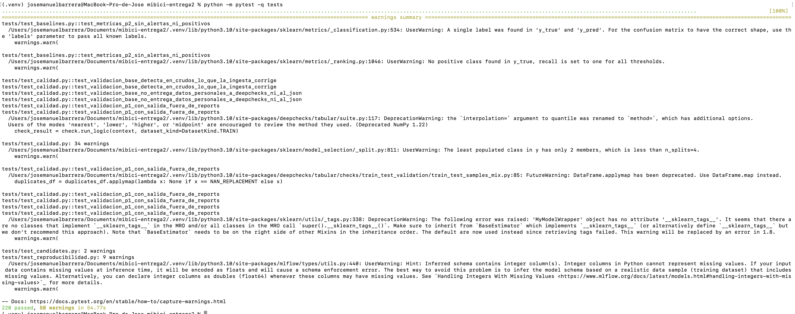
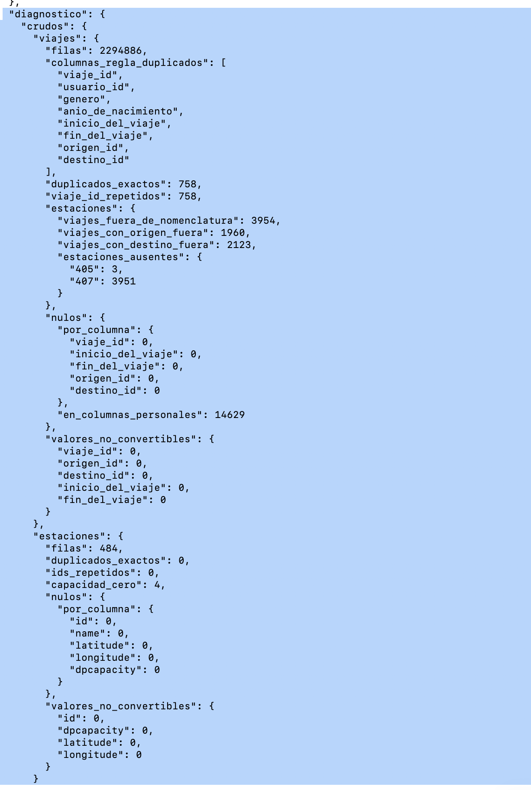
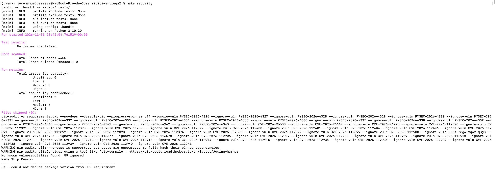
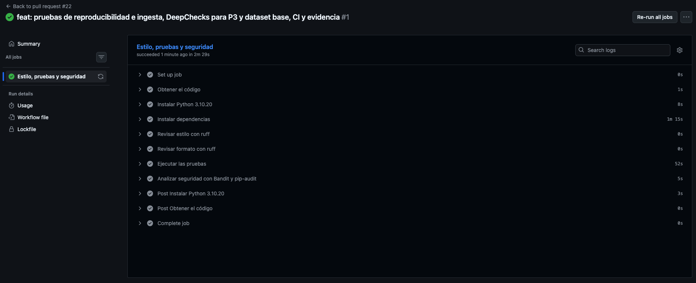

# MiBici: demanda, riesgo de rebalanceo y patrones de uso

[](https://github.com/a01840021-creator/TC5061-Proyecto-Equipo9/actions/workflows/ci.yml)

Proyecto integrador del equipo 9. Propone y construye una solución de Machine Learning sobre los datos abiertos de MiBici, el sistema de bicicleta pública del Área Metropolitana de Guadalajara, para responder tres preguntas de operación.

## Integrantes

### Entrega 1: propuesta y base reproducible

| Matrícula | Nombre | Contribución |
| --- | --- | --- |
| A01840021 | Carrera Rojas, Mariana Judith | Configuración inicial: estructura con Cookiecutter Data Science, repositorio en GitHub y protección de la rama principal |
| A01797854 | Barrera Mendoza, José Manuel | Formulación del problema y ML Canvas, definición de los datos, dependencias con versión fija, ingesta reproducible y versionado de datos, flujo de trabajo con Git |
| A01797868 | Barranco Cruz, Luis Fernando | Implementación de los baselines P1, P2 y P3; instrumentación con MLflow Tracking; métricas, artefactos y pruebas automatizadas |
| A01840136 | Carrera Castillo, David | Análisis exploratorio, módulo reutilizable de feature engineering sin fuga temporal y diagrama de arquitectura |

### Entrega 2: MLflow Project y tracking avanzado

| Integrante | Matrícula | Contribución | Evidencia |
| --- | --- | --- | --- |
| Carrera Rojas, Mariana Judith | A01840021 | Configuración inicial del MLflow Project, con los primeros puntos de entrada en `MLproject` y la declaración del entorno en `python_env.yaml`; revisión del reporte final y actualización de la documentación. | PR #12 (propuesta inicial, posteriormente sustituida y cerrada sin fusionar) y revisión aprobatoria del PR #16. |
| Barrera Mendoza, José Manuel | A01797854 | Modelos candidatos por algoritmo, corrección de fugas temporales en P2 y P3, selección automática mediante los aliases `champion` y `challenger`, linaje en Model Registry, corridas finales y reporte. | PR #15 y #16; revisión aprobatoria del PR #14. |
| Barranco Cruz, Luis Fernando | A01797868 | MLflow Project con puntos de entrada parametrizados, búsquedas con nested runs, registro estructurado de artefactos y primera automatización del Model Registry. | PR #13; revisión aprobatoria del PR #15. |
| Carrera Castillo, David | A01840136 | Primera versión del reporte de experimentos e integración de capturas y evidencias de MLflow. | PR #14; revisión aprobatoria del PR #13. |

*Nota:* El PR #12 se cerró sin fusionarse porque su configuración inicial fue sustituida y ampliada mediante los PR #13 y #15.

### Entrega 3: pruebas, calidad de datos y seguridad

| Integrante | Matrícula | Contribución | Evidencia |
| --- | --- | --- | --- |
| Carrera Rojas, Mariana Judith | A01840021 | Prueba de reproducibilidad del baseline de P3 con semilla fija. | PR #18. |
| Barranco Cruz, Luis Fernando | A01797868 | Integración de DeepChecks para P1 y P2 (nulos, duplicados y drift), pruebas sintéticas e interpretación de hallazgos. | PR #19 y revisión aprobatoria del PR #18. |
| Barrera Mendoza, José Manuel | A01797854 | Corrección de los chequeos de seguridad y fijación completa de dependencias (PR #21); pruebas de reproducibilidad del entrenamiento, pruebas de la ingesta, cobertura de funciones clave, DeepChecks para P3 y el dataset base, workflow de integración continua y evidencia (PR #22). | PR #21 y #22; revisión aprobatoria del PR #20. |
| Carrera Castillo, David | A01840136 | Bandit, pip-audit, `.env.example`, exclusiones de `.gitignore` y reporte de riesgo residual. | PR #20 y revisión aprobatoria del PR #19. |

## Preguntas del proyecto

| # | Pregunta | Tarea | Quién la usa |
| --- | --- | --- | --- |
| P1 | ¿Cuántos viajes se iniciarán en una estación o zona en un periodo futuro? | Regresión | Operador del sistema, para planear la flota |
| P2 | ¿Una estación estará en riesgo de quedarse sin bicicletas o sin anclajes? | Clasificación | Equipo de rebalanceo |
| P3 | ¿Qué grupos de estaciones comparten patrones de uso y dónde se ubican? | Clustering | Planeación urbana y expansión del sistema |

## Datos

- **Fuente:** [datos abiertos de MiBici](https://mibici.net/es/datos-abiertos/). Las URLs exactas de cada archivo están en `mibici/config.py`.
- **Rango:** abril a septiembre de 2026. Termina en el mismo mes que la nomenclatura de estaciones (`nomenclatura_2026_09.csv`), para que la capacidad y la ubicación de cada estación correspondan al final del periodo. Las 484 estaciones de esa nomenclatura incluyen 14 cuyo nombre lleva el prefijo "ex-"; ninguna de ellas registra viajes entre abril y septiembre. La nomenclatura no explica el prefijo.
- **Tamaño:** 2,294,886 registros crudos. Se eliminan 758 duplicados exactos y 3,954 viajes de dos estaciones (405 y 407) que no aparecen en la nomenclatura. Quedan **2,290,174 viajes** y **484 estaciones**.
- **Datos personales:** se eliminan en la ingesta `usuario_id`, `genero` y `anio_de_nacimiento`. Ninguna de las tres preguntas los necesita y no se registran en MLflow ni en el repositorio.
- **Partición:** temporal, para que ningún modelo se entrene con información posterior al periodo que predice. Los candidatos de P1 y P2 se entrenan de abril a julio, se validan en agosto y se prueban en septiembre; los baselines de P1 y P2 se evalúan en agosto y septiembre. En P3, los perfiles usan las salidas iniciadas y las llegadas terminadas antes del 1 de septiembre.
- **Versionado:** `references/manifiesto_datos.json` guarda la URL, el número de registros y el hash SHA-256 de cada archivo crudo, y una `version_datos` que se registra como parámetro en cada run de MLflow.

## Instalación

Requiere [uv](https://docs.astral.sh/uv/) y Git. Primero se clona el repositorio:

```bash
git clone https://github.com/a01840021-creator/TC5061-Proyecto-Equipo9.git
cd TC5061-Proyecto-Equipo9
```

Después se crea el entorno local, que da los comandos `mlflow`, `pytest` y `ruff`:

```bash
uv venv .venv --python 3.10.20
source .venv/bin/activate
uv pip install -r requirements.txt
```

`requirements.txt` fija cada paquete con `==` e instala el paquete `mibici` en modo editable. `python_env.yaml` declara la misma versión de Python y las mismas dependencias para `mlflow run`.

## Uso

Las corridas que se reportan se lanzan con `mlflow run` (ver [MLflow Project](#mlflow-project-y-tracking-avanzado)). Los módulos también se pueden ejecutar directamente durante el desarrollo, con el entorno activado y `MLFLOW_TRACKING_URI` exportada:

| Comando | Qué hace |
| --- | --- |
| `python -m mibici.dataset` | Descarga los seis meses y la nomenclatura, limpia, guarda en Parquet y escribe el manifiesto |
| `python -m mibici.modeling.train --pregunta all` | Ejecuta los baselines de P1, P2 y P3 |
| `python -m mibici.modeling.candidates search --pregunta P1` | Ejecuta la búsqueda de candidatos de una pregunta |
| `python -m mibici.modeling.registry` | Elige y registra el champion y el challenger de cada pregunta |
| `python -m pytest -q tests` | Ejecuta las pruebas automatizadas |
| `python -m mibici.quality --pregunta all` | Valida con DeepChecks P1, P2, P3 y el dataset base; `--pregunta` acepta `p1`, `p2`, `p3`, `base` o `all` |
| `bandit -c .bandit -r mibici/ tests/` | Ejecuta el análisis estático de seguridad (SAST) |
| `pip-audit -r requirements.txt --no-deps --disable-pip` | Audita las versiones fijadas en `requirements.txt` (SCA); lista también el riesgo aceptado |
| `make security` | Ejecuta Bandit y pip-audit con el riesgo aceptado declarado en el `Makefile`; termina en éxito si no hay hallazgos nuevos |
| `ruff check` y `ruff format --check` | Revisan el estilo del código |

## Pruebas y calidad de datos

### Pruebas automatizadas

Todas las pruebas están en `tests/` y se ejecutan con un solo comando:

```bash
python -m pytest -q tests
```

La suite tiene 220 pruebas y tarda alrededor de un minuto. No lee `data/`, no usa la red y no necesita un servidor de MLflow: `tests/conftest.py` genera viajes y estaciones sintéticos con semilla fija, da a cada prueba que registra en MLflow una base SQLite y una carpeta de artefactos dentro de `tmp_path`, y hace fallar cualquier conexión de red o resolución de nombres durante una prueba.

| Archivo | Qué comprueba |
| --- | --- |
| `test_reproducibilidad.py` | Entrena dos veces cada candidato con `ejecutar_p1`, `ejecutar_p2` y `ejecutar_p3` y exige las mismas predicciones, probabilidades y métricas (HistGradientBoosting y Ridge en P1; HistGradientBoosting y regresión logística en P2; K-Means, MiniBatch K-Means y Ward en P3). Comprueba que la semilla viene de `SEMILLA` en `mibici/config.py`, que con otra semilla HistGradientBoosting cambia y que el modelo registrado en MLflow se carga y predice igual |
| `test_ingesta.py` | Corre la ingesta completa con CSV sintéticos: nombres a snake_case ASCII, eliminación de datos personales, duplicados exactos con las ocho columnas, estaciones fuera de la nomenclatura, tipos y errores esperados, archivos sin filas, viajes en el borde de la ventana, hashes, `version_datos`, manifiesto y descarga sin red |
| `test_calidad.py` | Verificaciones de P3 y del dataset base con datos limpios y con duplicados, nulos y estaciones fuera de la nomenclatura; que ningún valor personal llega a DeepChecks ni al resumen; validación de P1 y opciones del CLI |
| `test_deepchecks.py` | Muestreo determinista y detección de duplicados, nulos y drift con chequeos de DeepChecks |
| `test_features.py` | Tablones de P1, P2 y P3, rezagos, filtro de viajes espurios sin fuga, rejilla estación-hora, partición temporal, purga y carga de los Parquet |
| `test_baselines.py` | Reglas base, métricas y sus casos límite, y reproducibilidad del baseline de P3 |
| `test_candidates.py` | Configuración de la búsqueda, construcción de modelos, registro de parámetros, configuración y muestra de entrenamiento en MLflow, y validación del CLI |
| `test_registry.py` | Selección, registro idempotente, aliases `champion` y `challenger`, linaje y carga de los modelos registrados |
| `test_train.py` | Commit y autor de Git con sus casos de error, etiquetas, parámetros comunes y baselines registrados en MLflow |
| `test_artifacts.py`, `test_clustering.py`, `test_config.py` y `test_mlproject.py` | Gráficas, Ward con asignación por centroide, constantes de configuración y valores por defecto de `MLproject` |

### Validación de datos con DeepChecks

Primero deben existir los CSV de `data/raw/` y los Parquet de `data/processed/`, que deja `python -m mibici.dataset`. Después:

```bash
python -m mibici.quality --pregunta all
```

| Opción | Qué valida | Reportes |
| --- | --- | --- |
| `--pregunta p1` y `--pregunta p2` | Tablones de entrenamiento y prueba de la partición temporal, con las suites `data_integrity` y `train_test_validation` | `reports/deepchecks/p1/` y `reports/deepchecks/p2/` |
| `--pregunta p3` | Perfiles de estaciones que agrupan los modelos de P3, con `data_integrity` más `Percent Of Nulls`, y conteos de perfiles repetidos, nulos, proporciones fuera de rango y estaciones fuera de la nomenclatura | `reports/deepchecks/p3/` |
| `--pregunta base` | Viajes y nomenclatura de `data/raw/` y de `data/processed/`, con `data_integrity` más `Percent Of Nulls`, y conteos sobre todas las filas de duplicados exactos, nulos, valores que no se pueden tipar y viajes con estaciones fuera de la nomenclatura | `reports/deepchecks/base/` |
| `--pregunta all` | Las cuatro anteriores; `make quality` ejecuta lo mismo | Las cuatro carpetas |

Cada carpeta recibe un HTML por suite y un `resumen.json` con los chequeos aprobados, no aprobados y no ejecutados y los conteos. `--max-filas` (5,000 por omisión) limita las filas que recibe DeepChecks por partición de P1 y P2 y por tabla de viajes; la muestra usa `SEMILLA=42`, así que dos ejecuciones sobre la misma versión de datos evalúan las mismas filas. Los perfiles de P3 y las estaciones se evalúan completos. `--salida` cambia el directorio de los reportes.

En la última corrida, los crudos tienen 758 duplicados exactos y 3,954 viajes con las estaciones 405 y 407, que no están en la nomenclatura; los procesados no tienen ninguno de los dos. Los crudos sólo tienen nulos en las columnas personales, que la ingesta elimina. Antes de construir el `Dataset` de DeepChecks se quitan `usuario_id`, `genero` y `anio_de_nacimiento`, y el resumen JSON sólo contiene conteos y nombres de chequeos y columnas, nunca valores ni registros. Los reportes quedan en `reports/deepchecks/`, que está en `.gitignore`, porque los HTML pueden mostrar filas de las muestras.

El drift no se oculta ni se considera automáticamente un error: al dividir por tiempo es posible que agosto y septiembre difieran de meses anteriores. Se documenta como señal para investigar y monitorear antes de promover un modelo.

Los resultados de P1, P2, P3 y del dataset base, su interpretación y las decisiones de tratamiento están en [`references/calidad_datos.md`](references/calidad_datos.md).

## Integración continua

Cada pull request hacia `main` y cada push a `main` ejecutan [`.github/workflows/ci.yml`](.github/workflows/ci.yml) en una máquina nueva de Ubuntu con Python 3.10.20: instala `requirements.txt` y corre `ruff check`, `ruff format --check`, `python -m pytest -q tests` y `make security`. Las pruebas y los chequeos de seguridad solo protegen el proyecto si se ejecutan en cada cambio, así que un cambio que rompe una prueba o agrega una vulnerabilidad que no está en la lista de riesgos aceptados se detecta en el pull request, antes de fusionarse. Como esa máquina no tiene datos, secretos ni servidor de MLflow, cada corrida comprueba además que las pruebas se reproducen desde un clon limpio. Solo usa la red para instalar las dependencias y para que pip-audit consulte las vulnerabilidades conocidas.

## Seguridad y gestión de riesgos

El repositorio revisa tres cosas: qué configuración y qué datos podrían filtrarse, qué patrones inseguros tiene el código (Bandit) y qué vulnerabilidades conocidas tienen las dependencias fijadas (pip-audit). Los dos análisis corren con un solo comando:

```bash
make security
```

### 1. Configuración y datos personales

- **Variables de entorno.** El código lee tres variables, todas con un valor por omisión en `mibici/config.py` y ninguna secreta: `MLFLOW_TRACKING_URI` (`http://127.0.0.1:5000`), `LOGURU_LEVEL` (`INFO`) y `LOGURU_COLORIZE` (`True`). Son las únicas que aparecen en `.env.example`.
- **`.gitignore`.** Excluye `.env` y `.env.*` (salvo `.env.example`), llaves y certificados (`*.pem`, `*.key`, `*.crt`, `*.pfx`, `*.p12`), archivos de credenciales (`credentials.json`, `client_secret*.json`, `token.json`, `secrets.json`), las bases y carpetas de MLflow (`mlflow.db`, `*.db`, `mlruns/`, `mlartifacts/`), los modelos serializados, los datos (`/data/`, `*.parquet`, `datos_abiertos_*.csv`) y los reportes locales.
- **Minimización en la ingesta.** Los datos abiertos de MiBici traen `usuario_id`, `genero` y `anio_de_nacimiento`. Ninguna pregunta los necesita, así que `mibici/dataset.py` los elimina en la ingesta (`COLUMNAS_PERSONALES`) después de usarlos solo para detectar duplicados exactos. No llegan a los Parquet procesados, a MLflow ni al repositorio; los CSV crudos que sí los contienen se quedan en `data/raw/`, fuera de Git.

### 2. Análisis estático con Bandit

```bash
bandit -c .bandit -r mibici/ tests/
```

`.bandit` no omite reglas de forma global. `B101` (`assert_used`) se omite solo en `tests/test_*.py`, donde pytest usa `assert`; en `mibici/` no hay asserts. Las dos llamadas a `git` de `mibici/modeling/train.py` (para registrar el autor y el commit de cada corrida) llevan `# nosec` con el código exacto de la regla (`B404` en el import de `subprocess`, `B603` y `B607` en cada llamada), porque usan una lista fija de argumentos, sin shell y sin datos de usuario.

Última corrida: 4,455 líneas escaneadas (2,476 en `mibici/` y 1,979 en `tests/`), 0 hallazgos de severidad alta, media o baja, 5 hallazgos omitidos por `# nosec` con código y ningún aviso de `nosec` en consola.

### 3. Auditoría de dependencias con pip-audit

```bash
pip-audit -r requirements.txt --no-deps --disable-pip
```

La auditoría lee las versiones fijadas en `requirements.txt`, no el entorno local. La actualización de `certifi` (a 2026.10.23), `mlflow` (a 3.17.2) y `pyasn1` (a 0.6.5) corrigió seis vulnerabilidades: PYSEC-2026-4320, CVE-2026-53995 y CVE-2026-119194 a CVE-2026-119197.

Quedan 59 vulnerabilidades en `pillow` 12.3.0 (39), `tornado` 6.5.10 (3) y `filelock` 4.1.0 (17), cuyas versiones corregidas exigen Python 3.11 o superior. Se aceptan de forma explícita: cada identificador está en el `Makefile` y `make security` lo pasa a pip-audit con `--ignore-vuln`, así que el comando falla si encuentra una vulnerabilidad cuyo identificador no está en esa lista. Las excepciones se revisan cuando cambian las versiones de las dependencias. El proyecto no abre imágenes (solo guarda PNG con matplotlib), Tornado solo corre al levantar Jupyter en la máquina local y `filelock` solo lo usa la caché HTTP de pip-audit.

El detalle de la configuración, los identificadores, el análisis de superficie de ataque y la relación con OWASP ML Top 10 y NIST AI RMF está en [`references/seguridad.md`](references/seguridad.md).

## MLflow Project y tracking avanzado

### 1. Servidor de tracking

El Model Registry necesita un almacén respaldado por base de datos. Desde la raíz del repositorio, con el entorno activado:

```bash
mlflow server --backend-store-uri sqlite:///mlflow.db --default-artifact-root ./mlartifacts --host 127.0.0.1 --port 5000
```

El servidor queda abierto en esa terminal y la interfaz en <http://127.0.0.1:5000>. `mlflow.db` y `mlartifacts/` se crean en la raíz del repositorio y están en `.gitignore`. En una segunda terminal, también en la raíz del repositorio:

```bash
source .venv/bin/activate
export MLFLOW_TRACKING_URI=http://127.0.0.1:5000
```

### 2. Reproducir todo desde un clon limpio

El archivo `MLproject` declara el entorno (`python_env.yaml`) y cinco puntos de entrada: `ingest`, `baseline`, `train`, `search` y `register`. Rutas, fechas, semilla, umbrales y nombre del experimento se leen de `mibici/config.py`. La secuencia completa es:

```bash
mlflow run . --experiment-name mibici-equipo09 --env-manager uv -e ingest --run-name ingest_datos
mlflow run . --experiment-name mibici-equipo09 --env-manager uv -e baseline
mlflow run . --experiment-name mibici-equipo09 --env-manager uv -e search -P pregunta=p1
mlflow run . --experiment-name mibici-equipo09 --env-manager uv -e search -P pregunta=p2
mlflow run . --experiment-name mibici-equipo09 --env-manager uv -e search -P pregunta=p3
mlflow run . --experiment-name mibici-equipo09 --env-manager uv -e register --run-name register_champion_challenger
```

`ingest` descarga los datos y escribe el manifiesto; `baseline` registra los tres baselines; cada `search` registra una corrida padre con una corrida hija por candidato; `register` elige y registra el mejor modelo de cada pregunta sin recibir ningún identificador de corrida.

Se usa `--env-manager uv` porque el gestor por defecto de MLflow, `virtualenv`, instala la versión de Python de `python_env.yaml` con pyenv y falla si pyenv no está instalado. Con uv, MLflow descarga Python 3.10.20 y crea el entorno sin pasos manuales.

Un candidato aislado se entrena con `train`, indicando la pregunta, el modelo y, si se quieren cambiar, sus hiperparámetros:

```bash
mlflow run . --experiment-name mibici-equipo09 --env-manager uv -e train \
  -P pregunta=p1 -P modelo=ridge -P alpha=10
```

| Pregunta | `modelo` | Hiperparámetros |
| --- | --- | --- |
| P1 | `hist_gradient_boosting`, `ridge` | `learning_rate`, `max_iter`, `max_leaf_nodes`, `l2_regularization`; `alpha` |
| P2 | `hist_gradient_boosting`, `logistic_regression` | los mismos de HistGradientBoosting; `C` |
| P3 | `kmeans`, `minibatch_kmeans`, `ward` | `n_clusters`, `batch_size` (MiniBatch), `estaciones` (`todas` o `activas`) |

Los valores por defecto de `train` son los de `mibici/config.py`; como `MLproject` no puede leer ese archivo, `tests/test_mlproject.py` falla si alguno se desalinea. MLflow registra todos los parámetros del punto de entrada en la corrida, aunque sólo apliquen los del modelo elegido; los que usa el modelo también quedan en `config/run_config.json`.

### 3. Diseño de la experimentación

| Pregunta | Candidatos de la búsqueda | Métrica de selección |
| --- | --- | --- |
| P1 | Tres `HistGradientBoostingRegressor` con distinta tasa de aprendizaje, iteraciones, hojas y regularización L2, y `Ridge` estandarizado | `val_mae`, menor es mejor |
| P2 | Tres `HistGradientBoostingClassifier` con pesos balanceados y una regresión logística estandarizada con `class_weight="balanced"` | `val_average_precision`, mayor es mejor |
| P3 | K-Means con k = 5 y k = 6, MiniBatch K-Means con k = 5, Ward con k = 5 y K-Means con k = 5 sin estaciones inactivas | `train_silhouette`, mayor es mejor, sólo entre corridas con todas las estaciones |

- **Partición.** Los candidatos de P1 y P2 se entrenan de abril a julio, se comparan en agosto (métricas `val_`) y se prueban en septiembre (métricas `test_`). Los baselines de P1 y P2 son reglas sin entrenamiento y se evalúan en las mismas dos ventanas, así que toda comparación usa los mismos datos. P3 agrupa los perfiles calculados antes del 1 de septiembre y sus métricas llevan el prefijo `train_`.
- **Selección.** Se elige por validación, nunca por prueba, para que septiembre siga siendo una medida honesta del modelo elegido.
- **Ward.** `AgglomerativeClustering` no tiene `predict`. `WardCentroides` (`mibici/modeling/clustering.py`) ajusta Ward, calcula el centroide de cada grupo y asigna cualquier estación nueva al centroide más cercano; así el modelo tiene firma y se carga desde MLflow como los demás.
- **Estaciones activas.** La corrida `P3_kmeans_k5_activas` excluye las estaciones sin salidas antes del corte (criterio `MIN_SALIDAS_ESTACION_ACTIVA` en `mibici/config.py`) y registra cuántas y cuáles excluyó. Se distingue por el parámetro `estaciones=activas`; su silhouette se calcula sobre otro conjunto de estaciones y no compite con las demás.
- **Etiquetas.** Toda corrida lleva `question`, `model_family`, `stage_of_work` (`baseline`, `search` o `candidate`), `equipo`, `git_commit` y `autor`.

Cada candidato registra:

- el modelo con firma e `input_example`;
- el manifiesto de datos en `data/` y una muestra del conjunto de entrenamiento con `mlflow.log_input`;
- gráficas en `plots/`: real contra predicho y residuales (P1), matriz de confusión y curva precisión-recall (P2), mapa y perfiles horarios de los grupos (P3);
- la configuración efectiva y `mibici/config.py` en `config/`;
- parámetros, métricas de validación y métricas de prueba.

### 4. Model Registry: aliases champion y challenger

`register` busca en el experimento las corridas con `stage_of_work=candidate` de cada pregunta, terminadas y del commit actual (etiqueta `git_commit` igual a `git rev-parse HEAD`), y las ordena por la métrica de selección de `METRICAS_SELECCION` en `mibici/config.py`. Registra la mejor con el alias `champion` y la segunda con `challenger`, en tres modelos:

| Pregunta | Modelo registrado |
| --- | --- |
| P1 | `mibici-equipo09-p1-demanda` |
| P2 | `mibici-equipo09-p2-riesgo` |
| P3 | `mibici-equipo09-p3-grupos` |

Cada modelo registrado tiene una descripción y cada versión, además de su descripción, las etiquetas `question`, `git_commit`, `data_version`, `source_run_id`, `experiment`, `selection_metric` y `selection_metric_value`. Con ellas se llega de la versión a la corrida, al commit y a la versión de datos que la produjeron. El punto de entrada es idempotente: si una versión ya proviene de la misma corrida, la reutiliza. Al final carga los tres `champion` para comprobar que se pueden usar.

Se usan aliases y no etapas porque las etapas (`Staging`, `Production`) están obsoletas en MLflow desde la versión 2.9. Un alias es un puntero con nombre que se mueve de una versión a otra sin crear versiones nuevas: promover un modelo o regresar al anterior es reasignar `champion`, y el código que consume el modelo no cambia. `challenger` deja identificada la siguiente mejor versión, para compararla con `champion` con datos nuevos antes de promoverla.

En producción, el modelo se carga por nombre y alias:

```python
import mlflow

mlflow.set_tracking_uri("http://127.0.0.1:5000")
modelo = mlflow.sklearn.load_model("models:/mibici-equipo09-p1-demanda@champion")
```

El entorno que carga el modelo debe tener instalado el paquete `mibici` (lo instala `requirements.txt`), porque el estimador de Ward vive en él.

### Baselines

| Pregunta | Baseline | Métricas principales | Artefactos |
| --- | --- | --- | --- |
| P1 | Demanda de la misma estación y hora una semana antes (`rezago_168h`) | MAE, RMSE, WAPE, R² y sesgo, en agosto (`val_`) y septiembre (`test_`) | Serie real frente a predicción, resumen horario y JSON de métricas |
| P2 | Persistencia del saldo de la hora anterior respecto de la capacidad | Precision, recall, F1, balanced accuracy y average precision, en agosto y septiembre | Matriz de confusión, riesgo diario y JSON de métricas |
| P3 | K-Means con `k=4` sobre perfiles horarios estandarizados | Silhouette, Davies-Bouldin, Calinski-Harabasz e inercia | Mapa de clusters, curvas horarias, tabla de estaciones y modelo |

La justificación de cada modelo y de cada métrica según la decisión que apoya está en [`references/modelos_metricas.md`](references/modelos_metricas.md).

## Estructura

```
├── .github/workflows/ci.yml integración continua: ruff, pytest y make security
├── Makefile                 comandos del proyecto (make data, make test, make quality, make security)
├── requirements.txt         dependencias con versión fija
├── pyproject.toml
├── data/                    no se versiona
│   ├── raw/                 CSV originales descargados
│   └── processed/           viajes.parquet y estaciones.parquet
├── docs/                    carpeta de la plantilla, sin contenido por ahora
├── models/                  modelos entrenados, no se versionan
├── notebooks/               solo exploración: 1.0-dcc-exploracion-inicial.ipynb
├── references/              manifiesto de datos, ML Canvas, definición de datos,
│                            modelos, métricas, arquitectura, calidad de datos y seguridad
├── reports/figures/         figuras generadas y capturas de evidencia
├── MLproject                puntos de entrada de mlflow run
├── python_env.yaml          entorno de mlflow run
├── tests/                   pruebas con datos sintéticos, sin red ni servidor de MLflow
└── mibici/
    ├── config.py            rutas, URLs, fechas, partición, umbrales, semilla y MLflow
    ├── dataset.py           ingesta reproducible
    ├── features.py          ingeniería de variables
    ├── quality.py           validación de P1, P2, P3 y el dataset base con DeepChecks
    ├── modeling/
    │   ├── artifacts.py     gráficas y tablas registradas en MLflow
    │   ├── baselines.py     reglas base y métricas de P1, P2 y P3
    │   ├── candidates.py    candidatos y búsquedas con nested runs
    │   ├── clustering.py    Ward con asignación por centroide
    │   ├── registry.py      selección y aliases en el Model Registry
    │   ├── train.py         CLI y tracking de los baselines
    │   └── predict.py       plantilla de Cookiecutter, sin usar
    └── plots.py             plantilla de Cookiecutter, sin usar
```

## Buenas prácticas

| Ámbito | Práctica | Cómo y dónde se cumple |
| --- | --- | --- |
| MLflow Tracking | Un experimento por proyecto y runs con nombre descriptivo | Todos los runs van al experimento `mibici-equipo09`, definido en `EXPERIMENTO` de `mibici/config.py`. `mibici/modeling/train.py` nombra los baselines `P1_baseline_rezago_semanal`, `P2_baseline_persistencia_saldo` y `P3_baseline_kmeans_k4`; `mibici/modeling/candidates.py` nombra cada búsqueda `P1_nested_search` y cada candidato por su modelo e hiperparámetros, por ejemplo `P1_hgb_lr005_iter100_leaf31` o `P3_ward_k5`. |
| MLflow Tracking | Registrar lo necesario para reproducir el run | Cada run registra como parámetros `fecha_inicio`, `fecha_fin`, `periodo_train`, `periodo_test`, `version_datos` (del manifiesto) y `semilla`, además del modelo y sus hiperparámetros: `umbral_capacidad` y `horizonte_horas` en P2; `n_clusters` y `n_init` en P3. |
| MLflow Tracking | Ligar cada run con su commit y su pregunta | Etiquetas `git_commit` (SHA de `git rev-parse HEAD`), `question` (`P1`, `P2` o `P3`), `model_family`, `stage_of_work`, `equipo` y `autor`, iguales en baselines y candidatos (`etiquetas` en `mibici/modeling/train.py`). |
| MLflow Tracking | Métricas con el conjunto en su nombre | Prefijo `val_` para agosto y `test_` para septiembre en P1 y P2 (`val_mae`, `test_recall`), y `train_` en P3, que se evalúa sobre los perfiles calculados antes del 1 de septiembre (`train_silhouette`). |
| MLflow Tracking | Sin credenciales ni datos de los usuarios de MiBici en parámetros, etiquetas o artefactos | La ingesta elimina `usuario_id`, `genero` y `anio_de_nacimiento`, las columnas con datos de los usuarios de MiBici, antes de guardar los Parquet (`mibici/dataset.py`), así que ningún artefacto puede contenerlas. La etiqueta `autor` registra tal cual el `user.name` de la configuración de Git de quien ejecuta o, si no está definido, el usuario del sistema (`obtener_autor` en `mibici/modeling/train.py`). El tracking es local y no usa credenciales; `.env` está en `.gitignore`. |
| Estructura y código | Notebooks sólo para exploración, con la convención de nombres | `notebooks/1.0-dcc-exploracion-inicial.ipynb` sigue el formato `número-iniciales-descripción` e importa las funciones de `mibici.features`; la lógica final vive en el módulo `mibici/`. |
| Estructura y código | Configuración en un solo lugar | Para el flujo de ingesta, construcción de variables y experimento, `mibici/config.py` concentra su propia ruta (que los candidatos registran como artefacto), las carpetas de datos, las rutas de los Parquet procesados, las URLs, las fechas, el corte de partición y el de validación, el retraso entre el cierre de cada ventana y la emisión de su predicción, que es también la duración mínima de un viaje válido, el umbral, el horizonte y el umbral de decisión de P2, los hiperparámetros por defecto de los modelos, el criterio de estación activa de P3, la semilla, el nombre del experimento, la URI de tracking, los nombres de los modelos registrados y la métrica de selección de cada pregunta. Los periodos que se registran en MLflow se derivan de esas constantes. El nombre local de cada CSV crudo se arma en `mibici/dataset.py` con la clave del mes. `mibici/modeling/predict.py` y `mibici/plots.py` son plantillas de Cookiecutter sin usar y conservan sus rutas de ejemplo. |
| Estructura y código | Dependencias con versión fija y entorno reproducible | `requirements.txt` fija con `==` cada paquete; la instalación con Python 3.10 está en [Instalación](#instalación). |
| Datos y Git | Ningún dato, modelo, carpeta de MLflow ni credencial en el historial | `.gitignore` excluye `/data/`, `*.parquet`, `datos_abiertos_*.csv`, `mlruns/`, `mlartifacts/`, `mlflow.db`, `models/*`, `*.pkl`, `*.joblib`, `*.skops` y `.env`. Los datos se versionan con su hash en `references/manifiesto_datos.json`, no con los archivos. |
| Testing | Pruebas repetibles con casos normales y límite | `tests/` se ejecuta con PyTest sobre datos sintéticos, con una base de MLflow temporal y sin red. Incluye la reproducibilidad de los candidatos de P1, P2 y P3 y del baseline de P3 con semilla fija, la ingesta completa con CSV sintéticos y validaciones sintéticas que demuestran que los chequeos de calidad detectan nulos, duplicados, drift y estaciones fuera de la nomenclatura. |
| Testing | Cada cambio hacia `main` se verifica automáticamente | `.github/workflows/ci.yml` ejecuta `ruff check`, `ruff format --check`, `python -m pytest -q tests` y `make security` en cada push a `main` y en cada pull request hacia `main`. |
| Datos y Git | Todo cambio entra a `main` por Pull Request revisado | La rama `main` está protegida con un ruleset que exige un Pull Request con al menos una aprobación e impide el push directo y el borrado. Ver [Flujo de trabajo con Git](#flujo-de-trabajo-con-git). |

## Flujo de trabajo con Git

Seguimos [GitHub Flow](https://docs.github.com/en/get-started/using-github/github-flow).

- **Rama principal protegida.** Nadie hace push directo a `main`. Todo cambio entra por Pull Request con al menos una revisión aprobada de otro integrante.
- **Una rama por tarea**, creada desde `main` y borrada al fusionarse. Si una tarea depende de otra que aún no se fusiona, la rama nueva sale de esa y su PR se apila sobre el anterior.
- **Nombres de rama:** `tipo/descripcion-corta`, en minúsculas y con guiones. Por ejemplo, `feat/ingesta-mibici` o `chore/fijar-dependencias`.
- **Commits:** [Conventional Commits](https://www.conventionalcommits.org/es/v1.0.0/), con el mismo tipo que la rama.

| Tipo | Para qué |
| --- | --- |
| `feat` | Funcionalidad nueva |
| `fix` | Corrección de un error |
| `docs` | Documentación |
| `chore` | Mantenimiento: dependencias, configuración |
| `refactor` | Reestructurar código sin cambiar su comportamiento |
| `test` | Pruebas |

- **Lo que nunca entra al repositorio:** datos de MiBici, carpetas de MLflow (`mlruns/`, `mlartifacts/`), modelos serializados ni credenciales (`.env`).

## Evidencia

Las capturas se toman desde el commit final de `main`, con el entorno activado en la raíz del repositorio.



Las 220 pruebas aprobadas, obtenidas con `python -m pytest -q tests`.



El resumen del dataset base que imprime `python -m mibici.quality --pregunta all`: 758 duplicados exactos y 3,954 viajes con estaciones fuera de la nomenclatura en los datos crudos, que la ingesta elimina. Los resultados de los datos procesados (0 y 0) y de las suites de DeepChecks están en `references/calidad_datos.md`.



Bandit sin hallazgos y pip-audit sin vulnerabilidades fuera de las 59 aceptadas, obtenidos con `make security`.



Una corrida exitosa del workflow `CI` de `.github/workflows/ci.yml` en GitHub Actions, con los pasos de ruff, pytest y `make security` aprobados.
