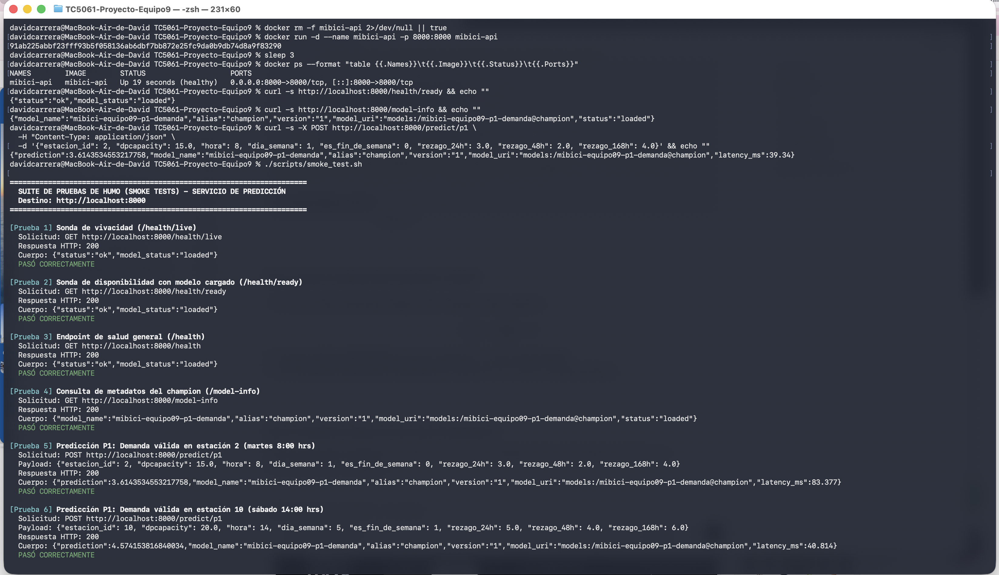
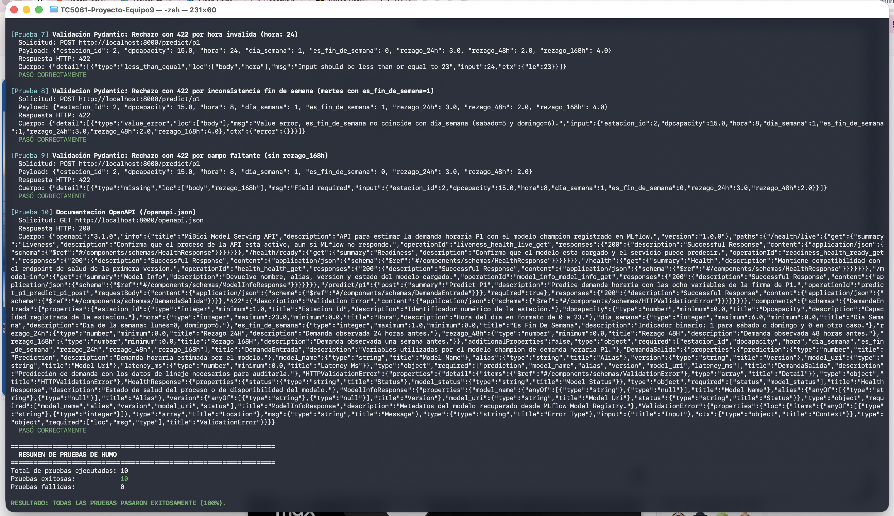

# Evidencia de Ejecución: API REST en Contenedor (Semana 8)

**Proyecto:** TC5061 - Sistemas de Aprendizaje Máquina (Equipo 09)  
**Entregable:** Entrega 4 — Servicio de predicción en contenedor OCI (Docker / Podman)  
**Responsable de evidencia y pruebas integrales:** David Carrera Castillo (A01840136)

---

## 1. Resumen del Servicio Contenerizado

El servicio expone el modelo **champion de demanda horaria (P1)** (`mibici-equipo09-p1-demanda@champion`, versión 1) a través de una API REST construida con **FastAPI**, empaquetada en una imagen de contenedor compatible con el estándar OCI (Docker / Podman).

Características de la imagen:
- **Base:** `python:3.10.20-slim`.
- **Seguridad:** Ejecución con usuario no privilegiado (`api`, UID 10001), sin acceso root.
- **Independencia (Offline / Standalone):** Empaqueta los artefactos serializados del modelo en `models/p1/`, permitiendo que el contenedor funcione de forma idéntica en cualquier máquina sin depender de un servidor externo de MLflow ni de conexión de red en tiempo de ejecución.
- **Sonda de salud integrada:** `HEALTHCHECK` configurado contra `/health/ready`.

---

## 2. Construcción y Ejecución del Contenedor

### 2.1 Construcción de la imagen

```bash
docker build -t mibici-api .
```

*Salida exitosa:*
```text
[+] Building 57.8s (14/14) FINISHED
 => naming to docker.io/library/mibici-api:latest
```

### 2.2 Despliegue del contenedor

```bash
docker run -d --name mibici-api -p 8000:8000 mibici-api
```

### 2.3 Verificación de estado en ejecución

```bash
docker ps --format "table {{.Names}}\t{{.Image}}\t{{.Status}}\t{{.Ports}}"
```

*Resultado:*
```text
NAMES        IMAGE        STATUS                    PORTS
mibici-api   mibici-api   Up 2 minutes (healthy)    0.0.0.0:8000->8000/tcp, [::]:8000->8000/tcp
```

El estado `(healthy)` confirma que el `HEALTHCHECK` interno de Docker validó la disponibilidad del modelo en `/health/ready`.

---

## 3. Peticiones de Prueba con `curl`

### 3.1 Disponibilidad y estado del modelo (`GET /health/ready`)

```bash
curl -s http://localhost:8000/health/ready
```

**Respuesta JSON (HTTP 200 OK):**
```json
{
  "status": "ok",
  "model_status": "loaded"
}
```

### 3.2 Metadatos del modelo champion (`GET /model-info`)

```bash
curl -s http://localhost:8000/model-info
```

**Respuesta JSON (HTTP 200 OK):**
```json
{
  "model_name": "mibici-equipo09-p1-demanda",
  "alias": "champion",
  "version": "1",
  "model_uri": "models:/mibici-equipo09-p1-demanda@champion",
  "status": "loaded"
}
```

### 3.3 Predicción de demanda (`POST /predict/p1`) — Caso normal

Petición de inferencia para la estación 2, un martes a las 8:00 hrs (hora pico laboral):

```bash
curl -s -X POST http://localhost:8000/predict/p1 \
  -H "Content-Type: application/json" \
  -d '{
    "estacion_id": 2,
    "dpcapacity": 15.0,
    "hora": 8,
    "dia_semana": 1,
    "es_fin_de_semana": 0,
    "rezago_24h": 3.0,
    "rezago_48h": 2.0,
    "rezago_168h": 4.0
  }'
```

**Respuesta JSON (HTTP 200 OK):**
```json
{
  "prediction": 3.6143534553217758,
  "model_name": "mibici-equipo09-p1-demanda",
  "alias": "champion",
  "version": "1",
  "model_uri": "models:/mibici-equipo09-p1-demanda@champion",
  "latency_ms": 11.945
}
```

- `prediction`: Demanda estimada de 3.61 viajes en la ventana horaria solicitada.
- `latency_ms`: Tiempo de inferencia en milisegundos.
- Linaje completo retornado en cada respuesta (`model_name`, `alias`, `version`, `model_uri`).

### 3.4 Validación de entradas robusta (Casos límite y errores 422)

Prueba con una hora inválida fuera del rango permitido (`hora = 24`):

```bash
curl -s -X POST http://localhost:8000/predict/p1 \
  -H "Content-Type: application/json" \
  -d '{
    "estacion_id": 2,
    "dpcapacity": 15.0,
    "hora": 24,
    "dia_semana": 1,
    "es_fin_de_semana": 0,
    "rezago_24h": 3.0,
    "rezago_48h": 2.0,
    "rezago_168h": 4.0
  }'
```

**Respuesta JSON (HTTP 422 Unprocessable Entity):**
```json
{
  "detail": [
    {
      "type": "less_than_equal",
      "loc": ["body", "hora"],
      "msg": "Input should be less than or equal to 23",
      "input": 24,
      "ctx": { "le": 23 }
    }
  ]
}
```

---

## 4. Automatización con Suite de Pruebas de Humo (`scripts/smoke_test.sh`)

Se diseñó el script ejecutable `scripts/smoke_test.sh` (integrado también en el `Makefile` como `make smoke-test`) para automatizar la verificación integral contra el contenedor:

```bash
./scripts/smoke_test.sh
```

**Resultado de la ejecución:**
```text
======================================================================
  SUITE DE PRUEBAS DE HUMO (SMOKE TESTS) - SERVICIO DE PREDICCIÓN   
  Destino: http://localhost:8000
======================================================================

[Prueba 1] Sonda de vivacidad (/health/live)
  Respuesta HTTP: 200 | PASÓ CORRECTAMENTE
[Prueba 2] Sonda de disponibilidad con modelo cargado (/health/ready)
  Respuesta HTTP: 200 | PASÓ CORRECTAMENTE
[Prueba 3] Endpoint de salud general (/health)
  Respuesta HTTP: 200 | PASÓ CORRECTAMENTE
[Prueba 4] Consulta de metadatos del champion (/model-info)
  Respuesta HTTP: 200 | PASÓ CORRECTAMENTE
[Prueba 5] Predicción P1: Demanda válida en estación 2 (martes 8:00 hrs)
  Respuesta HTTP: 200 | PASÓ CORRECTAMENTE
[Prueba 6] Predicción P1: Demanda válida en estación 10 (sábado 14:00 hrs)
  Respuesta HTTP: 200 | PASÓ CORRECTAMENTE
[Prueba 7] Validación Pydantic: Rechazo con 422 por hora inválida (hora: 24)
  Respuesta HTTP: 422 | PASÓ CORRECTAMENTE
[Prueba 8] Validación Pydantic: Rechazo con 422 por inconsistencia fin de semana
  Respuesta HTTP: 422 | PASÓ CORRECTAMENTE
[Prueba 9] Validación Pydantic: Rechazo con 422 por campo faltante (sin rezago_168h)
  Respuesta HTTP: 422 | PASÓ CORRECTAMENTE
[Prueba 10] Documentación OpenAPI (/openapi.json)
  Respuesta HTTP: 200 | PASÓ CORRECTAMENTE

======================================================================
  RESUMEN DE PRUEBAS DE HUMO
======================================================================
Total de pruebas ejecutadas: 10
Pruebas exitosas:            10
Pruebas fallidas:            0

RESULTADO: TODAS LAS PRUEBAS PASARON EXITOSAMENTE (100%).
```

---

## 5. Capturas de Evidencia Visual

### 5.1 Petición de predicción y estado del contenedor en Docker
Muestra el contenedor ejecutándose en estado `(healthy)`, las consultas con `curl` a `/health/ready` y `/model-info`, y la petición `POST /predict/p1` con las variables de entrada devolviendo la estimación de demanda en formato JSON y el tiempo de latencia:



### 5.2 Suite de pruebas de humo y validaciones Pydantic
Muestra la ejecución de las pruebas 7 a 10 de `scripts/smoke_test.sh`, confirmando el rechazo con código 422 ante horas fuera de rango, inconsistencias de fecha o campos faltantes, y el resumen final con 10/10 pruebas aprobadas (100%):


