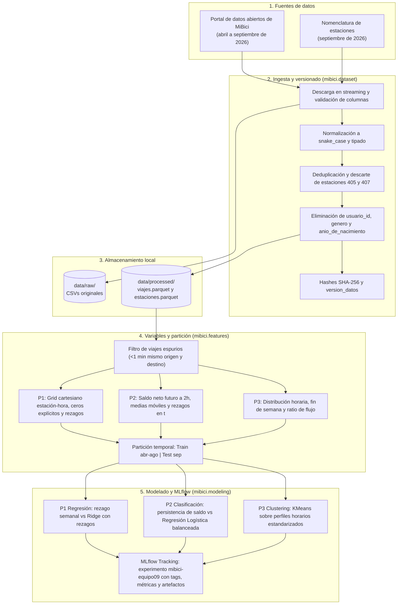

# Arquitectura del Sistema

Proyecto MiBici, equipo 9. Este documento describe los componentes del sistema para las tres preguntas del proyecto, el flujo de datos entre etapas y las herramientas utilizadas, con base en las lecturas de la semana (Sculley et al., 2015; Fowler, 2019).

## Diagrama de componentes

## Herramientas y justificación

| Componente | Herramienta | Justificación |
| --- | --- | --- |
| Ingesta | `requests`, `typer`, `hashlib` | Automatiza la descarga por streaming de archivos grandes y genera hashes reproducibles sin pasos manuales. |
| Almacenamiento | Parquet (`pyarrow`) | Reduce el peso de los viajes de ~200 MB a 43 MB, conserva tipos de datos y acelera la lectura de columnas para análisis temporal. |
| Variables | `pandas`, `numpy` | Permite operaciones vectorizadas sobre series de tiempo (shift, rolling) y generación del producto cartesiano estación-hora para completar ceros. |
| Modelado | `scikit-learn` | Implementa baselines estándar, escalamiento y particiones sin introducir dependencias pesadas innecesarias en la fase inicial. |
| Registro de experimentos | `mlflow` | Centraliza parámetros, métricas con prefijo de partición y artefactos visuales, ligando cada run con el commit de Git y la versión de datos. |

## Prevención de fuga de información

- **Partición temporal:** entrenamiento del 1 de abril al 31 de agosto de 2026 y prueba en septiembre de 2026.
- **P1:** las variables predictoras usan rezagos de al menos 24 horas ($t-24\text{h}, t-48\text{h}, t-168\text{h}$) y variables de calendario, disponibles al cierre del día anterior.
- **P2:** las variables de la hora $t$ usan solo datos observados hasta $t$. Las dos últimas horas de agosto se descartan de entrenamiento para que la ventana futura de 2 horas no cruce a septiembre.
- **P3:** los perfiles y el agrupamiento se ajustan únicamente con los datos del periodo de entrenamiento.
