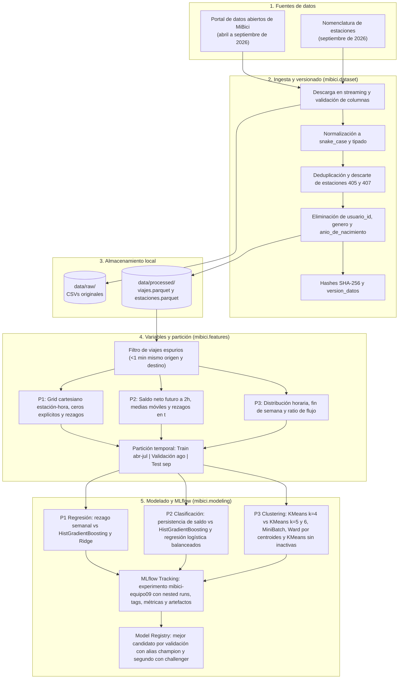

# Arquitectura del sistema

Proyecto MiBici, equipo 9. Este documento describe los componentes del sistema para las tres preguntas del proyecto, el flujo de datos entre etapas y las herramientas utilizadas en cada componente, con su justificación técnica y, donde existe, el respaldo de la literatura de MLOps (Sculley et al., 2015; Treveil et al., 2020).

## Diagrama de componentes

Todo el flujo se ejecuta con `mlflow run` desde el archivo `MLproject`: `ingest` corre el bloque 2, `baseline` y `search` los bloques 4 y 5 hasta el tracking, y `register` el Model Registry. Los baselines y los candidatos de las tres preguntas están implementados y justificados en `references/modelos_metricas.md`.

## Herramientas y justificación

| Componente | Herramienta | Justificación |
| --- | --- | --- |
| Ingesta y versionado de datos | `requests`, `typer`, `hashlib` | La descarga, la limpieza y el manifiesto se ejecutan con un solo comando, sin pasos manuales. El manifiesto guarda el SHA-256 de cada archivo crudo y una `version_datos` que se registra en cada run. Es la estrategia que Sculley et al. (2015, sección 3) proponen ante dependencias de datos inestables: trabajar con una copia versionada de la señal en lugar de consumirla mientras cambia. Treveil et al. (2020, p. 26) señalan que la reproducibilidad real exige control de versiones de todos los activos, incluidos los datos de entrenamiento y evaluación, y un registro del entorno de software; este último lo cubre `requirements.txt` con versiones fijas. |
| Almacenamiento | Parquet (`pyarrow`) | Justificación técnica: los seis CSV ocupan 199.2 MB y el Parquet de viajes 45.2 MB; el formato es columnar, conserva los tipos (fechas y enteros) y permite leer sólo las columnas necesarias. |
| Variables | `pandas`, `numpy` | Las transformaciones viven en funciones reutilizables de `mibici/features.py`, no en celdas sueltas ni en archivos intermedios. Así se evitan las *pipeline jungles*, que Sculley et al. (2015, sección 5) describen como una maraña de extracciones, uniones y muestreos con archivos intermedios, difícil de probar y de mantener. `shift` y `rolling` por estación construyen los rezagos sobre la rejilla completa estación y hora. |
| Modelado | `scikit-learn` | Escalador y modelo se encadenan en un `Pipeline` en Ridge, la regresión logística y los agrupamientos de P3, así que el escalador se ajusta sólo con el entrenamiento y viaja con el modelo registrado. El agrupamiento aglomerativo de Ward no tiene `predict`; `WardCentroides` (`mibici/modeling/clustering.py`) lo envuelve en un estimador compatible con scikit-learn que asigna cada estación nueva al grupo del centroide más cercano, calculado en el mismo espacio estandarizado, y así se registra y se carga como los demás. Sculley et al. (2015, sección 5) recomiendan envolver los paquetes genéricos en interfaces comunes para no acumular *glue code* y poder probar alternativas sin reescribir el sistema. |
| Configuración | `mibici/config.py` | Fechas, corte de partición, umbral y horizonte de P2, hiperparámetros de K-Means, semilla y nombre del experimento se definen una sola vez. Sculley et al. (2015, sección 6) advierten que la configuración acumula deuda técnica y piden que sea fácil comparar dos configuraciones y que se revise y versione en el repositorio como el código. La semilla fija responde a la deuda de reproducibilidad por algoritmos aleatorios (Sculley et al., 2015, sección 8). |
| Registro de experimentos | MLflow Tracking con almacén SQLite local | MLflow Tracking registra, en cada ejecución del código, parámetros, versión del código, métricas y archivos de salida, y agrupa los runs en experimentos (MLflow, s.f.); aquí, un solo experimento reúne los runs de las tres preguntas. Treveil et al. (2020, p. 26) explican que una herramienta de seguimiento de experimentos evita perder la configuración exacta de los mejores resultados, porque guarda los datos, las variables y los parámetros junto con las métricas y permite comparar experimentos lado a lado. Las etiquetas `git_commit` y `version_datos` permiten volver al estado exacto de un experimento, una de las dos necesidades de la gestión de versiones que describen Treveil et al. (2020, p. 56). |
| Proyecto y registro de modelos | MLflow Projects y Model Registry | `MLproject` declara el entorno (`python_env.yaml`) y los puntos de entrada, de modo que la ingesta, los baselines, las búsquedas y el registro se reproducen con `mlflow run` desde un clon limpio. `register` elige el mejor candidato de cada pregunta por su métrica de validación, lo registra con el alias `champion` y al segundo con `challenger`, y deja en cada versión las etiquetas de corrida, commit, experimento y versión de datos. |
| Control de versiones y colaboración | Git y GitHub, con rama principal protegida y Pull Requests | Treveil et al. (2020, p. 75) presentan Git como el sistema que mantiene un historial claro de cambios, permite regresar a una versión previa y deja que varios colaboradores trabajen en sus ramas antes de integrarlas a la principal. También advierten que Git no está diseñado para guardar archivos binarios grandes ni para versionar los datos; por eso los datos, `mlruns/` y los modelos se excluyen con `.gitignore` y los datos se versionan con el manifiesto. |
| Estructura del proyecto | Cookiecutter Data Science | Ofrece una estructura de proyecto lógica, flexible y razonablemente estandarizada: datos crudos inmutables en `data/raw/`, datos finales en `data/processed/`, notebooks con la convención `número-iniciales-descripción`, el código fuente en un módulo de Python y `requirements.txt` para reproducir el entorno (DrivenData, s.f.). |

## Prevención de fuga de información

- **Partición temporal:** los candidatos de P1 y P2 se entrenan del 1 de abril al 31 de julio de 2026, se validan en agosto y se prueban en septiembre; la selección para el Model Registry usa sólo validación.
- **Momento de emisión:** cada predicción se emite al cierre de su ventana más `RETRASO_DISPONIBILIDAD_SEG` (60 segundos), la misma constante que define un viaje espurio. A esa hora el desenlace de cualquier viaje espurio ya es observable, así que el filtro de viajes espurios no usa información posterior a la emisión.
- **P1:** las variables predictoras usan rezagos de al menos 24 horas ($t-24\text{h}, t-48\text{h}, t-168\text{h}$) y variables de calendario, disponibles al emitir la predicción, tras el cierre del día anterior. El mes no es variable, porque entrenamiento, validación y prueba cubren meses distintos.
- **P2:** la predicción de la hora $t$ se emite al cierre de esa hora más el retraso y sus variables usan solo datos de la hora $t$ y anteriores. Las dos últimas horas de agosto se descartan de entrenamiento para que la ventana futura de 2 horas no cruce a septiembre, y las dos últimas de julio, del entrenamiento de los candidatos, para que no cruce a validación.
- **P3:** los perfiles se emiten al corte más el retraso y, con el agrupamiento, usan sólo eventos anteriores al 1 de septiembre: salidas por fecha de inicio y llegadas por fecha de fin, contadas de forma independiente.

## Referencias

DrivenData. (s.f.). *Cookiecutter Data Science*. https://cookiecutter-data-science.drivendata.org/

MLflow. (s.f.). *MLflow Tracking* [Documentación]. https://mlflow.org/docs/latest/ml/tracking/

Sculley, D., Holt, G., Golovin, D., Davydov, E., Phillips, T., Ebner, D., Chaudhary, V., Young, M., Crespo, J.-F., & Dennison, D. (2015). Hidden technical debt in machine learning systems. En C. Cortes, N. Lawrence, D. Lee, M. Sugiyama, & R. Garnett (Eds.), *Advances in Neural Information Processing Systems* (Vol. 28). Curran Associates. https://proceedings.neurips.cc/paper/2015/file/86df7dcfd896fcaf2674f757a2463eba-Paper.pdf

Treveil, M., Omont, N., Stenac, C., Lefèvre, K., Phan, D., Zentici, J., Lavoillotte, A., Miyazaki, M., & Heidmann, L. (2020). *Introducing MLOps: How to scale machine learning in the enterprise*. O'Reilly Media.
