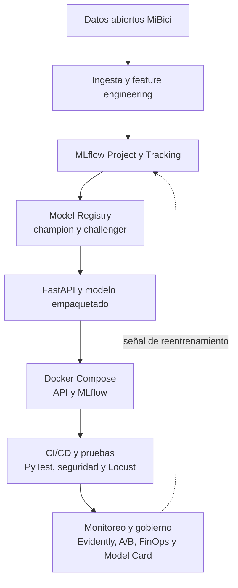

# Arquitectura final de MLOps

Este documento resume cómo los componentes acumulados durante el curso forman un sistema
de *Machine Learning* reproducible y operable. El detalle del procesamiento de datos y de
las tres preguntas se conserva en [`references/arquitectura.md`](arquitectura.md).

## Flujo de extremo a extremo

## Componentes y contratos

| Etapa | Implementación | Evidencia o contrato |
| --- | --- | --- |
| Datos | `mibici/dataset.py`, `mibici/features.py` | Manifiesto SHA-256, partición temporal y pruebas sintéticas |
| Experimentación | `MLproject`, `mibici/modeling/` | Runs, parámetros, métricas, artefactos y `git_commit` en MLflow |
| Registro | `mibici/modeling/registry.py` | Alias `champion`/`challenger`, versión, `run_id` y periodo de entrenamiento |
| Servicio | `app/`, `Dockerfile` | Esquemas Pydantic, healthchecks, usuario no-root y modelo exportado |
| Orquestación | `docker-compose.yml` | API y MLflow saludables, red, volumen y límites de recursos |
| Automatización | `.github/workflows/ci.yml` | Ruff, PyTest, Bandit, pip-audit, construcción y smoke tests |
| Operación | `locustfile.py`, `mibici/load_testing/` | Latencia, RPS, errores, CPU y memoria del mismo experimento |
| Monitoreo | `mibici/monitoring/` | Drift, comparación A/B y política de *Continuous Training* |
| Gobernanza | `MODEL_CARD.md`, `references/finops.md` | Uso previsto, limitaciones, riesgo y costo por inferencia |

## Reproducibilidad

La versión de Python está fijada en `python_env.yaml`, `Dockerfile` y GitHub Actions. Las
dependencias tienen versiones exactas y los entry points de `MLproject` reproducen ingesta,
baselines, candidatos, búsquedas y registro. El comando `make audit-final` verifica estos
contratos sin descargar datos ni levantar infraestructura externa.

La auditoría distingue entre:

- **Errores técnicos:** componentes ausentes, versiones desalineadas, dependencias sin fijar,
  entry points incompletos o linaje insuficiente. Estos bloquean la reproducción.
- **Pendientes de entrega:** Model Card, presentación y video. Se reportan durante la
  integración y sólo bloquean `make audit-final-strict`.

## Operación y retroalimentación

El servicio de inferencia carga el champion exportado desde el Model Registry. Docker
Compose levanta FastAPI y MLflow con healthchecks; GitHub Actions reconstruye y valida el
stack en cada PR. Locust mide el comportamiento bajo carga y Evidently vigila el cambio en
los datos. El A/B testing compara champion y challenger sobre el mismo periodo, mientras que
FinOps traduce la demanda y el consumo observados a costo por inferencia. Estas señales
alimentan la política de reentrenamiento documentada en
[`references/interpretacion_drift.md`](interpretacion_drift.md).
