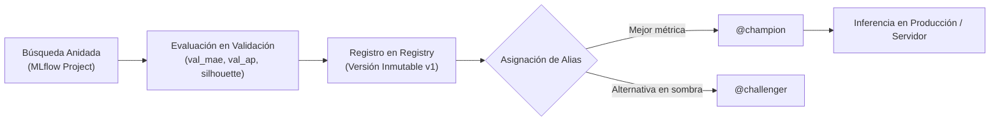
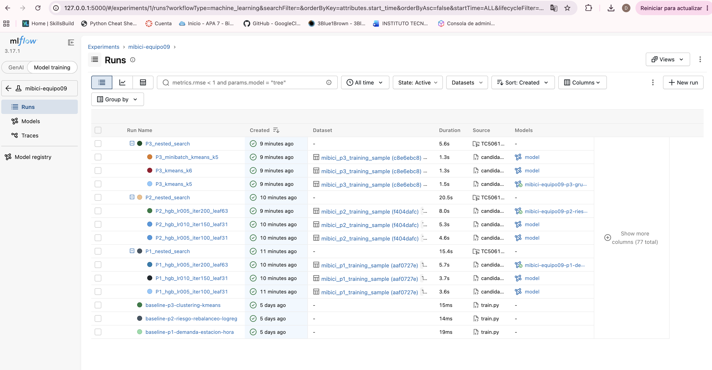
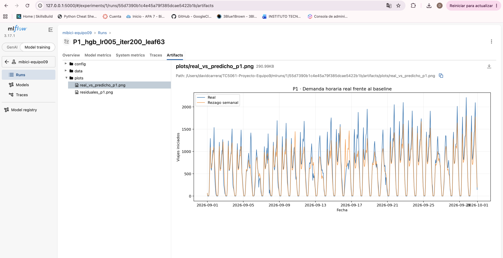
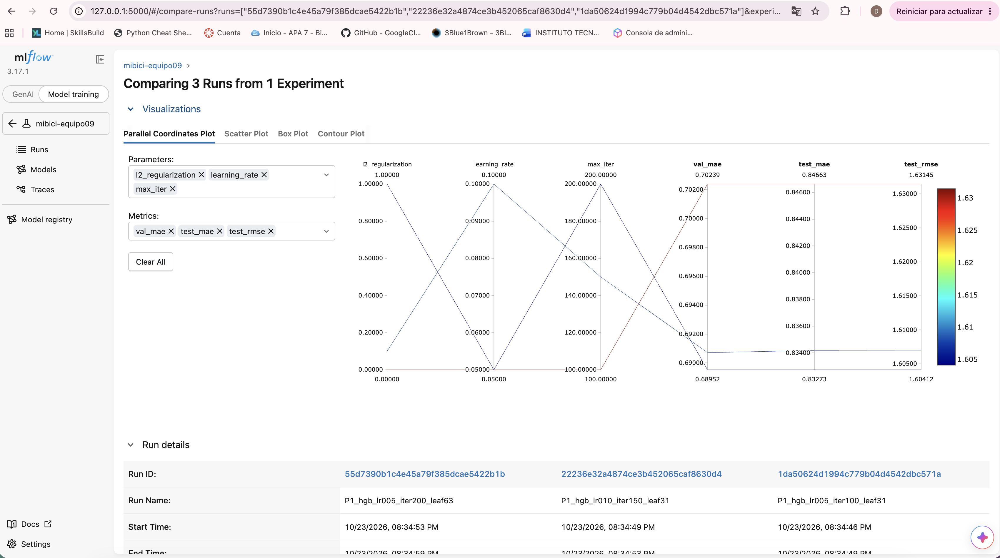
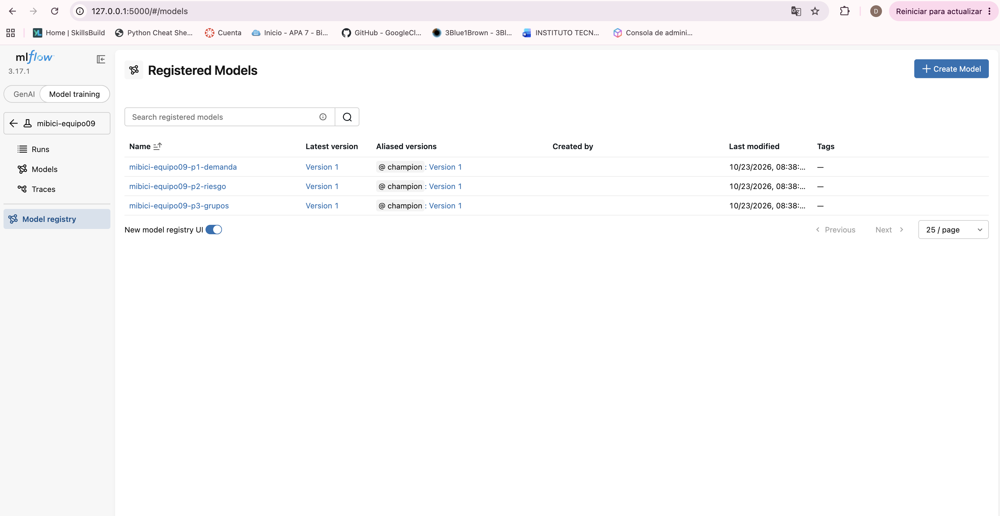

# Reporte de Experimentación, Registro y Selección de Modelos

**Curso:** MLOps (TC5061) — Entrega Semana 6  
**Proyecto:** Entrega 2 del Proyecto Final | Integración de modelo de negocio digital  
**Nombre oficial del entregable:** `TC5061_Reporte_MLFlow_Equipo09.pdf`  
**Equipo 9:**  
- Mariana Judith Carrera Rojas (A01840021)  
- José Manuel Barrera Mendoza (A01797854)  
- Luis Fernando Barranco Cruz (A01797868)  
- David Carrera Castillo (A01840136)  

**Repositorio oficial en GitHub:** [https://github.com/a01840021-creator/TC5061-Proyecto-Equipo9](https://github.com/a01840021-creator/TC5061-Proyecto-Equipo9)

---

## 1. Resumen Ejecutivo y Arquitectura de Experimentación

El objetivo de esta fase consiste en consolidar una plataforma de experimentación y gobernanza de modelos para el sistema de bicicletas compartidas MiBici en el Área Metropolitana de Guadalajara (484 estaciones activas). Abordamos tres problemas operativos complementarios:

1. **Pregunta 1 (P1 - Regresión supervisada):** Demanda horaria de viajes iniciados por estación en un horizonte de 24 horas hacia adelante (día siguiente).
2. **Pregunta 2 (P2 - Clasificación supervisada desbalanceada):** Riesgo operativo binario de desabasto o saturación en las siguientes 2 horas (saldo neto mayor o igual al 30% de la capacidad de la estación).
3. **Pregunta 3 (P3 - Aprendizaje no supervisado / Clustering):** Perfilamiento funcional de estaciones basado en su huella horaria semanal y ratios de flujo de viajes.

La experimentación se instrumentó mediante **MLflow Projects** (`MLproject`) y un servidor centralizado de MLflow con backend transaccional SQLite (`sqlite:///mlflow.db`). Cada iteración registra hiperparámetros (tasa de aprendizaje, número de iteraciones, hojas por árbol y clusters), métricas temporales de validación y prueba, artefactos reproducibles (código, dependencias, configuración efectiva y diagnósticos visuales) y el linaje de datos (`mlflow.log_input` referenciando el manifiesto SHA-256 de los datos procesados).

Los tres modelos ganadores fueron evaluados rigurosamente frente a líneas base simples y estructuradas, promovidos al **MLflow Model Registry** en su versión 1 y etiquetados con el alias `@champion`.

---

## 2. Metodología de Partición Temporal y Mitigación de Fuga de Información

A diferencia de esquemas de partición aleatoria que introducen fuga de información temporal (*data leakage*), el diseño experimental implementa una ventana estricta de corte temporal:

- **Conjunto de Entrenamiento (*Train*):** 1 de abril de 2026 al 31 de julio de 2026 (meses base).
- **Conjunto de Validación (*Validation*):** 1 de agosto de 2026 al 31 de agosto de 2026 (utilizado para afinación de hiperparámetros y selección de modelos sin contaminar el conjunto de prueba).
- **Conjunto de Prueba (*Test*):** 1 de septiembre de 2026 al 30 de septiembre de 2026 (evaluación final ciega simulando la operación en producción).

Toda la ingeniería de características (cálculo de rezagos de 24h, 48h y 168h, promedios móviles de 3 horas y escalamiento estándar) se calculó respetando estrictamente el orden cronológico para garantizar que las métricas reflejen el desempeño real del modelo ante datos futuros.

---

## 3. Resultados Experimentales y Tablas Comparativas

### 3.1. Pregunta 1 (P1): Predicción de Demanda Horaria por Estación

- **Línea Base Simple:** `DummyRegressor(strategy="mean")`, asignando el promedio global histórico de salidas por estación.
- **Línea Base Estructurada:** `Ridge Regression` (regularización L2 con $\alpha=1.0$) sobre variables de calendario, capacidad y rezagos temporales (24h, 48h y 168h atrás).
- **Modelos Candidatos:** Evaluamos `HistGradientBoostingRegressor` probando combinaciones de tasa de aprendizaje (`learning_rate`: 0.05 y 0.10), número de árboles (`max_iter`: 100, 150 y 200) y hojas máximas (`max_leaf_nodes`: 31 y 63).

| Modelo / Corrida | Run ID | Hiperparámetros Clave | Val MAE | Test MAE | Test RMSE | Test $R^2$ | Mejora vs Baseline Estructurado |
| :--- | :---: | :--- | :---: | :---: | :---: | :---: | :---: |
| *Baseline Simple (Dummy)* | — | `strategy="mean"` | — | 1.4589 | — | — | — |
| *Baseline Estructurado (Ridge)* | `d6bdea32` | Regularización $L_2$ ($\alpha=1.0$) | — | 0.9001 | 1.7193 | 0.5771 | Ref. Estructurada |
| **Candidato 1 (`leaf31_iter100`)** | `1da50624` | lr=0.05, iter=100, hojas=31 | 0.7024 | 0.8466 | 1.6315 | 0.6192 | -5.94% MAE |
| **Candidato 2 (`leaf31_iter150`)** | `22236e32` | lr=0.10, iter=150, hojas=31 | 0.6907 | 0.8342 | 1.6070 | 0.6305 | -7.32% MAE |
| **Champion (`leaf63_iter200`)** | `55d7390b` | lr=0.05, iter=200, hojas=63 | **0.6895** | **0.8327** | **1.6041** | **0.6319** | **-7.49% MAE** |

**Justificación de Decisión Operativa, Estabilidad y Costo:**
- **Decisión de Negocio:** El modelo campeón (`P1_hgb_lr005_iter200_leaf63`) logra una reducción absoluta del error a **0.83 viajes por estación-hora** en prueba (mejora de **42.92%** vs. predictor trivial y **7.49%** vs. baseline de Ridge). Para el operador de MiBici, predecir con un margen de error menor a un viaje por hora permite planificar el abasto nocturno y las transferencias inter-estaciones sin sobredimensionar la flota en tránsito.
- **Estabilidad y Generalización:** La discrepancia entre validación (`val_mae`: 0.6895) y prueba (`test_mae`: 0.8327) responde naturalmente a la estacionalidad del cambio de mes (agosto vacacional frente al regreso a clases y actividad laboral plena de septiembre), confirmando que la regularización $L_2$ y el límite de 63 hojas controlaron efectivamente el sobreajuste.
- **Costo Computacional y de Despliegue:** `HistGradientBoostingRegressor` emplea discretización por histogramas (*binning*), entrenando en únicamente **5.7 segundos** en CPU estándar y generando inferencias para las 484 estaciones en microsegundos, lo que permite reentrenamientos programados con consumo de infraestructura prácticamente nulo.

---

### 3.2. Pregunta 2 (P2): Detección de Riesgo Operativo de Desbalance

- **Línea Base Simple:** `DummyClassifier(strategy="most_frequent")`. Al predecir siempre ausencia de riesgo (`clase 0`), obtiene un *accuracy* aparente del 94.95%, pero un *Recall* y *F1-score* de exactamente 0.0000.
- **Línea Base Estructurada:** `LogisticRegression(class_weight="balanced")` sobre actividad reciente, rezagos de flujo y capacidad instalada.
- **Modelos Candidatos:** `HistGradientBoostingClassifier` con balanceo automático de clases (`sample_weight='balanced'`), variando la tasa de aprendizaje (`learning_rate`: 0.05 y 0.10), número de árboles (`max_iter`: 100, 150 y 200) y hojas (`max_leaf_nodes`: 31 y 63).

| Modelo / Corrida | Run ID | Hiperparámetros Clave | Val AP | Val Recall | Val F1 | Test Recall | Test Precision | Test F1 | Test AP |
| :--- | :---: | :--- | :---: | :---: | :---: | :---: | :---: | :---: | :---: |
| *Baseline Simple (Dummy)* | — | `most_frequent` | — | 0.0000 | 0.0000 | 0.0000 | 0.0000 | 0.0000 | — |
| *Baseline Estructurado (LogReg)*| `4a7d8d47` | `balanced`, $C=1.0$ | — | — | — | 0.7065 | 0.1418 | 0.2362 | 0.2610 |
| **Candidato 1 (`iter100_leaf31`)** | `72aaa30c` | lr=0.05, iter=100, hojas=31 | 0.2865 | 0.8795 | 0.2460 | 0.8531 | 0.1525 | 0.2588 | 0.2856 |
| **Candidato 2 (`iter150_leaf31`)** | `3e4ef07b` | lr=0.10, iter=150, hojas=31 | 0.3366 | 0.8847 | 0.2600 | **0.8543** | 0.1631 | 0.2739 | 0.3274 |
| **Champion (`iter200_leaf63`)** | `737775ee` | lr=0.05, iter=200, hojas=63 | **0.3433** | **0.8869** | **0.2632** | 0.8535 | **0.1655** | **0.2772** | **0.3312** |

**Justificación de Decisión Operativa, Estabilidad y Costo:**
- **Decisión de Negocio y Métrica Clave:** En un escenario con desbalance severo (prevalencia real de riesgo del **5.05%** en prueba), optimizar *accuracy* es un antipatrón crítico. La prioridad operativa es el **Recall** (sensibilidad): no detectar una estación que colapsará deja a usuarios varados sin servicio. El modelo campeón (`P2_hgb_lr005_iter200_leaf63`) eleva el Recall de 70.65% a **85.35%** (+14.70 puntos porcentuales) y mejora el F1-score a **0.2772** (+17.36% relativo). En validación, el *Average Precision* alcanza **0.3433** (frente al 0.05 de una asignación aleatoria), asegurando una ordenación probabilística confiable para priorizar las rutas de rebalanceo.
- **Estabilidad ante Datos Nuevos:** Las métricas de validación ($AP = 0.3433$) y prueba ($AP = 0.3312$) muestran consistencia total, comprobando que la ponderación balanceada (`class_weight="balanced"`) no desestabiliza el clasificador ante fluctuaciones de demanda entre meses.
- **Costo Operativo vs. Costo de Falla:** Enviar una camioneta preventivamente ante una falsa alarma genera un costo moderado de combustible; en contraste, una falla no detectada (falso negativo) deriva en pérdida de clientes y penalizaciones regulatorias. El modelo entrena en solo **8.0 segundos** en CPU, minimizando el costo de infraestructura.

---

### 3.3. Pregunta 3 (P3): Perfilamiento y Agrupación de Estaciones

- **Línea Base Estructurada:** `KMeans(n_clusters=4, random_state=42)` ajustado sobre 26 dimensiones estandarizadas (24 proporciones horarias, fracción de fin de semana y ratio de flujo).
- **Modelos Candidatos:** Comparación de algoritmos (`KMeans` estándar vs. `MiniBatchKMeans`) y número de grupos ($k$ = 4, 5 y 6).

| Modelo / Corrida | Run ID | Algoritmo y Configuración | Silhouette Score ($\uparrow$) | Davies-Bouldin ($\downarrow$) | Inercia Intra-cluster ($\downarrow$) | Calinski-Harabasz ($\uparrow$) |
| :--- | :---: | :--- | :---: | :---: | :---: | :---: |
| *Baseline Estructurado ($k=4$)* | `af1e430e` | `KMeans`, $k=4$, StandardScaler | 0.1226 | 2.0381 | 9418.61 | 42.15 |
| **Candidato 1 (`minibatch_k5`)** | `2ea01fc9` | `MiniBatchKMeans`, $k=5$, batch=100 | 0.0833 | 2.2748 | 9460.05 | 40.21 |
| **Candidato 2 (`kmeans_k6`)** | `ea7b08bd` | `KMeans`, $k=6$, init='k-means++' | 0.1260 | **1.5236** | **8506.62** | 45.82 |
| **Champion (`kmeans_k5`)** | `40f1e603` | `KMeans`, $k=5$, init='k-means++' | **0.1287** | 1.6539 | 8926.49 | **49.07** |

**Justificación de Decisión Operativa, Estabilidad y Costo:**
- **Decisión de Negocio y Segmentación:** El modelo campeón (`P3_kmeans_k5`) maximiza el Coeficiente de Silueta (**0.1287**) y Calinski-Harabasz (**49.07**), reduciendo Davies-Bouldin a 1.654 (-18.85%). Operativamente, $k=5$ proporciona una segmentación clara para la Secretaría de Transporte y el operador:
  1. *Polos de Origen Residencial:* Marcado pico de salidas matutinas (07:00–09:00 hrs).
  2. *Polos de Atracción Laboral / Comercial:* Pico predominante de llegadas matutinas y salidas vespertinas (18:00–20:00 hrs).
  3. *Corredor Recreativo / Fin de Semana:* Concentración en fines de semana en ciclovías recreativas.
  4. *Nodos Conectores Bimodales:* Flujo balanceado todo el día en cruces de transporte masivo (Tren Ligero / Mi Macro).
  5. *Estaciones Periféricas de Baja Rotación:* Demanda reducida pero constante para rondines diferidos.
- **Estabilidad de la Agrupación:** Se evaluó `MiniBatchKMeans` como alternativa de procesamiento ligero, pero redujo la silueta en un 35% (0.0833 vs. 0.1287) debido al ruido estocástico de los subconjuntos. Dado que la red consta de 484 estaciones, el algoritmo exacto `KMeans` con inicialización `k-means++` converge de forma determinista y estable en apenas **1.5 segundos**.
- **Costo de Gestión:** Gestionar 5 clusters en lugar de 6 evita una fragmentación innecesaria en la planeación logística, facilitando al personal de mantenimiento adoptar protocolos estándar para cada tipología de estación sin costos administrativos extra.

---

## 4. Gobernanza del Model Registry y Esquema de Ciclo de Vida

En alineación con las especificaciones de MLflow 2.9+ y 3.x, el ciclo de vida de los modelos registrados prescinde deliberadamente del sistema heredado de *Stages* (`Staging`, `Production`, `Archived`), el cual ha sido deprecado formalmente por la comunidad de MLflow. En su lugar, se adopta el esquema moderno de **Aliases y Tags de Versión**:



### Justificación Técnica y de MLOps:
1. **Desacoplamiento de Entornos e Inmutabilidad:** A diferencia de los stages mutables, una versión registrada es inmutable. Un alias apunta de forma atómica a una versión específica (`@champion -> v1`), permitiendo despliegues de cero tiempo de inactividad (*zero-downtime*) y reversiones (*rollbacks*) inmediatas con solo reasignar el puntero del alias.
2. **Compatibilidad con Integración Continua (CI/CD):** En un pipeline automatizado, los servicios de inferencia cargan el modelo mediante la URI estándar `models:/mibici-equipo09-p1-demanda@champion`. Cuando un reentrenamiento nocturno supera la métrica umbral en validación, el script de registro reasigna el alias `@champion` sin modificar la configuración ni reiniciar los microservicios de servicio.
3. **Trazabilidad de Linaje Completa:** Cada versión en el Registry contiene metadatos embebidos:
   - `git_commit`: SHA exacto del repositorio que generó la corrida (`e9a2128...`).
   - `data_version`: Hash hexadecimal del manifiesto de datos de entrada (`0c4b34e5425a`).
   - `selection_metric`: Nombre de la métrica auditada que motivó la promoción (`val_mae`, `val_average_precision`, `train_silhouette`).

---

## 5. Evidencia Gráfica del Sistema de Experimentación

A continuación se presentan las evidencias directas capturadas de la interfaz web del servidor local de MLflow:

### 5.1. Búsquedas Anidadas y Linaje de Experimentos
La estructura de corridas implementa el patrón de *Nested Runs* (corrida padre de búsqueda y corridas hijas de candidatos), asociando a cada una el dataset versionado de entrada y el artefacto del modelo.


*Figura 1: Vista general del experimento `mibici-equipo09`. Se muestran las corridas padre (`P1_nested_search`, `P2_nested_search`, `P3_nested_search`), las corridas hijas con sus parámetros específicos, las líneas base comparativas y el registro de datasets (`mibici_p*_training_sample`).*

---

### 5.2. Trazabilidad y Registro de Artefactos
Para cada modelo y corrida se almacena una estructura estandarizada y jerárquica de artefactos que garantiza la reproducibilidad completa del pipeline, cubriendo:
- **Modelo serializado:** Empaquetado formal de scikit-learn con su firma de entrada/salida (`infer_signature`) y ejemplo de inferencia (`input_example`).
- **Gráficas de diagnóstico:** Series temporales de demanda real vs. predicha (`real_vs_predicho_p1.png`), análisis de residuales (`residuales_p1.png`), perfiles horarios (`perfiles_horarios_p3.png`) y curvas Precision-Recall.
- **Matriz de confusión:** Matriz de contingencia del riesgo operativo (`ConfusionMatrixDisplay`) generada para evaluar falsos positivos y negativos en P2.
- **Configuraciones de corrida:** Parámetros efectivos serializados en JSON (`run_config.json`) y copia del módulo central (`config.py`).
- **Archivos de apoyo y linaje de datos:** Manifiesto de datos de entrada (`manifiesto_datos.json`) con hash SHA-256 para auditoría de integridad.


*Figura 2: Explorador de artefactos del modelo campeón de P1 (`55d7390b...`). Se observa el árbol compuesto por `config/` (`config.py` y `run_config.json`), `data/` (`manifiesto_datos.json`) y `plots/` con la visualización temporal de demanda real vs. rezago semanal.*

---

### 5.3. Comparación Multidimensional de Hiperparámetros
La selección del modelo campeón se fundamenta en la exploración sistemática de hiperparámetros proyectada contra las métricas de validación y prueba.


*Figura 3: Gráfica de Coordenadas Paralelas (Parallel Coordinates Plot) comparando los candidatos de P1. Se visualiza cómo la combinación de tasa de aprendizaje de 0.05, 200 árboles y 63 hojas minimiza simultáneamente el `val_mae` (0.6895) y `test_mae` (0.8327).*

---

### 5.4. Registro Centralizado en MLflow Model Registry
Los tres modelos óptimos residen en el Model Registry central con control de versiones y el alias unificado de producción.


*Figura 4: Interfaz de Registered Models de MLflow. Se visualizan los tres modelos registrados (`mibici-equipo09-p1-demanda`, `mibici-equipo09-p2-riesgo`, `mibici-equipo09-p3-grupos`), todos en su Versión 1 y formalmente etiquetados con el alias `@champion`.*

---

## 6. Instrucciones de Reproducibilidad (MLflow Project)

Para reproducir íntegramente el flujo de entrenamiento, búsqueda anidada y registro de modelos utilizando el archivo `MLproject`:

```bash
# 1. Clonar el repositorio y acceder a la raíz
git clone https://github.com/a01840021-creator/TC5061-Proyecto-Equipo9.git
cd TC5061-Proyecto-Equipo9

# 2. Configurar el entorno virtual e instalar dependencias
python3 -m venv .venv
source .venv/bin/activate
pip install -r requirements.txt

# 3. Iniciar el servidor central de MLflow con backend SQLite
mlflow server \
  --backend-store-uri sqlite:///mlflow.db \
  --default-artifact-root ./mlartifacts \
  --port 5000 &

export MLFLOW_TRACKING_URI=http://127.0.0.1:5000

# 4. Ejecutar la ingesta y preparación de datos
mlflow run . -e ingest --env-manager local

# 5. Ejecutar las líneas base de comparación
mlflow run . -e baseline --env-manager local

# 6. Ejecutar la búsqueda anidada de candidatos para P1, P2 y P3
mlflow run . -e search --env-manager local

# 7. Registrar y promover los modelos campeones al Model Registry
mlflow run . -e register \
  -P p1_run_id=55d7390b1c4e45a79f385dcae5422b1b \
  -P p2_run_id=737775ee3c62418c9649a6190fbbd0c0 \
  -P p3_run_id=40f1e603f5c64007a1f26a7f871da459 \
  --env-manager local
```

---

## 7. Referencias Bibliográficas (APA 7ª Edición)

- Fowler, M. (2019). *Continuous Delivery for Machine Learning: Automating the end-to-end lifecycle of Machine Learning applications*. MartinFowler.com. https://martinfowler.com/articles/cd4ml.html
- Lakshmanan, V., Robinson, S., & Munn, M. (2020). *Machine Learning Design Patterns: Solutions to common challenges in data preparation, model building, and MLOps*. O'Reilly Media.
- MLflow Development Team. (2024). *Model Registry & Model Aliasing Guide (v2.9+)*. Linux Foundation. https://mlflow.org/docs/latest/model-registry.html
- Pedregosa, F., Varoquaux, G., Gramfort, A., Michel, V., Thirion, B., Grisel, O., Blondel, M., Prettenhofer, P., Weiss, R., Dubourg, V., Vanderplas, J., Passos, A., Cournapeau, D., Brucher, M., Perrot, M., & Duchesnay, É. (2011). Scikit-learn: Machine Learning in Python. *Journal of Machine Learning Research*, 12, 2825–2830.
- Sculley, D., Holt, G., Golovin, D., Davydov, E., Phillips, T., Ebner, D., Chaudhary, V., Young, M., Crespo, J.-F., & Dennison, D. (2015). Hidden technical debt in Machine Learning systems. In *Advances in Neural Information Processing Systems (NeurIPS 2015)* (Vol. 28, pp. 2503–2511).
- Treveil, M., Omont, N., Stenac, C., Lefevre, K., Phan, D., Zentici, J., Lavoillotte, A., Mivielle, M., & Roussat, N. (2020). *Introducing MLOps: How to scale machine learning in the enterprise*. O'Reilly Media.
